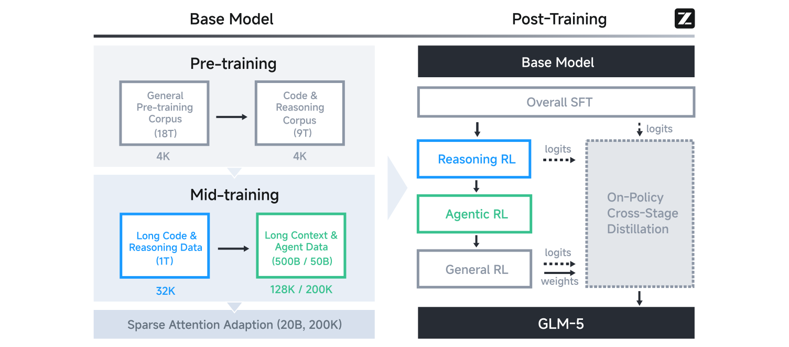
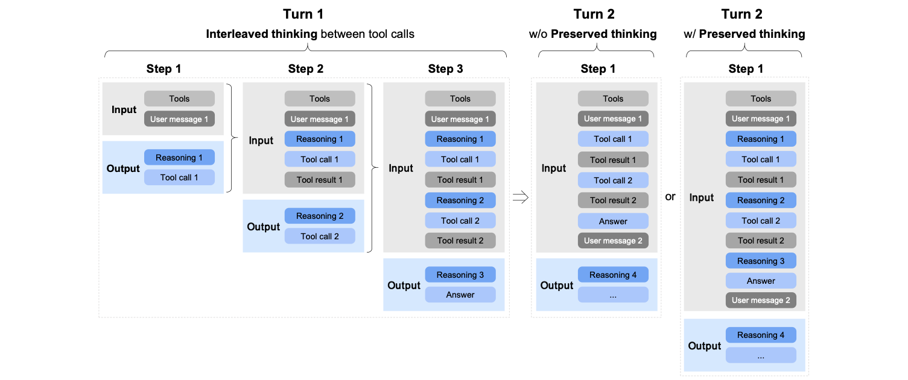

# GLM-5: from Vibe Coding to Agentic Engineering

arXiv 技术报告（[arXiv:2602.15763](https://arxiv.org/abs/2602.15763)）。

作者：GLM-5 Team（智谱、清华大学）

## 整体架构与稀疏注意力适配

如图所示，GLM-5 构建了总参数 744B、激活参数 40B 的 MoE 基座，在 28.5T tokens 上扩窗至 200K 后经多阶段 RL 与蒸馏完成对齐。注意力模块以 MLA 压缩 KV Cache，提出将上投影矩阵按头拆分后独立正交化的 Muon Split 以对齐 GQA 精度，并增大头维数以降低 decode 开销。MTP 模块在训练时跨多步共享参数，在不增加草稿模型显存的前提下缓解投机解码的训推不一致。中期训练结束后，模型通过预热 indexer 与全模型稀疏训练两阶段引入 DeepSeek Sparse Attention（DSA），将长序列注意力计算量降低约 1.5 至 2 倍。

## 长上下文基座训练与系统优化

基座训练依次经历通用与代码数理预训练以及递进扩窗至 200K 的中期训练，重点扩充大规模仓库级 Issue–PR 序列与交错拼接的合成长程依赖数据。为支撑超大规模长序列训练，基础设施将 MTP 输出层与主输出层共置于末级流水线 stage 共享参数，其余组件前移一级以均衡显存。系统进一步结合双缓冲流水线 ZeRO-2 梯度分片、分片内局部通信的零冗余 Muon 优化器、逐层主机内存激活卸载与分块输出投影降低峰值显存。针对长序列负载不均，训练侧引入负载感知序列重排、可变规模上下文并行与层次化通信重叠，并在 SFT 阶段应用训推逐位一致的 INT4 量化感知训练。

## 混合思考范式与监督微调

如图所示，GLM-5 在对话模板中引入交错思考与跨轮保留思考机制，使长程多轮工具交互保持推理连贯。SFT 阶段大幅扩充真实可执行环境中的编码与智能体轨迹，保留轨迹内的错误动作并在损失中掩码，引导模型学习自我纠错。Interleaved Thinking 在每次回复与工具调用前均插入思考块，Preserved Thinking 则在多轮编码会话中跨轮保留全部历史思考块以防信息丢失。此外，Turn-level Thinking 支持会话内按轮次动态开关思考，兼顾轻量请求的低延迟与复杂任务的高精度。

## 推理强化学习与跨阶段在线蒸馏

后训练依次串联推理 RL、智能体 RL 与通用 RL，并在末期通过跨阶段在线蒸馏消除多阶段串行优化引发的能力遗忘。推理 RL 引入 IcePop 截断训推概率比偏离过大的样本，并在训练引擎中冻结 DSA indexer 且改用确定性 `torch.topk` 算子以消除熵骤降。通用 RL 融合规则奖励、结果奖励模型与生成式奖励模型，并引入人工高质回复作为风格锚点消除机器腔。最后的跨阶段在线蒸馏以前序各 RL 阶段的检查点为教师，将策略梯度中的优势项替换为无梯度回传的对数概率差：

$$
\hat{A}_{i,t} = \mathrm{sg}\left[ \log \frac{\pi_{\theta_{\mathrm{teacher}}}^{\mathrm{infer}}(y_{i,t} \mid x, y_{i,<t})}{\pi_{\theta}^{\mathrm{train}}(y_{i,t} \mid x, y_{i,<t})} \right]
$$

该优势直接度量学生与各阶段教师的分布差距，无需组内采样估计即可高吞吐恢复早期专长。

## 异步智能体强化学习与环境扩展

为消除长尾交互造成的设备空闲，GLM-5 将训推完全解耦，通过中心协调器将异构任务封装为独立微服务并支持超千路并发 rollout。推理侧依托 slime 框架结合 Prefill-Decode 分离、FP8 与 MTP 加速，并用一致性哈希将同一轨迹绑定至固定数据并行节点以复用前缀 KV Cache。训练侧通过 Token-in-Token-out（TITO）网关直接传递 token ID 流以防重分词错位，用采样概率做双侧信任域掩码并过滤陈旧与崩溃轨迹。环境层面，团队构建了超 1 万个多语言软件工程沙箱、自校验容器终端、配合旧观测折叠的多跳搜索环境以及带运行时渲染校验的幻灯片环境。
