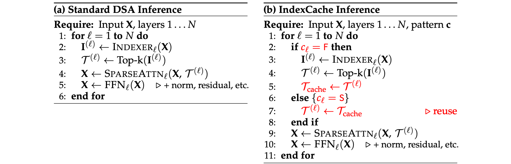
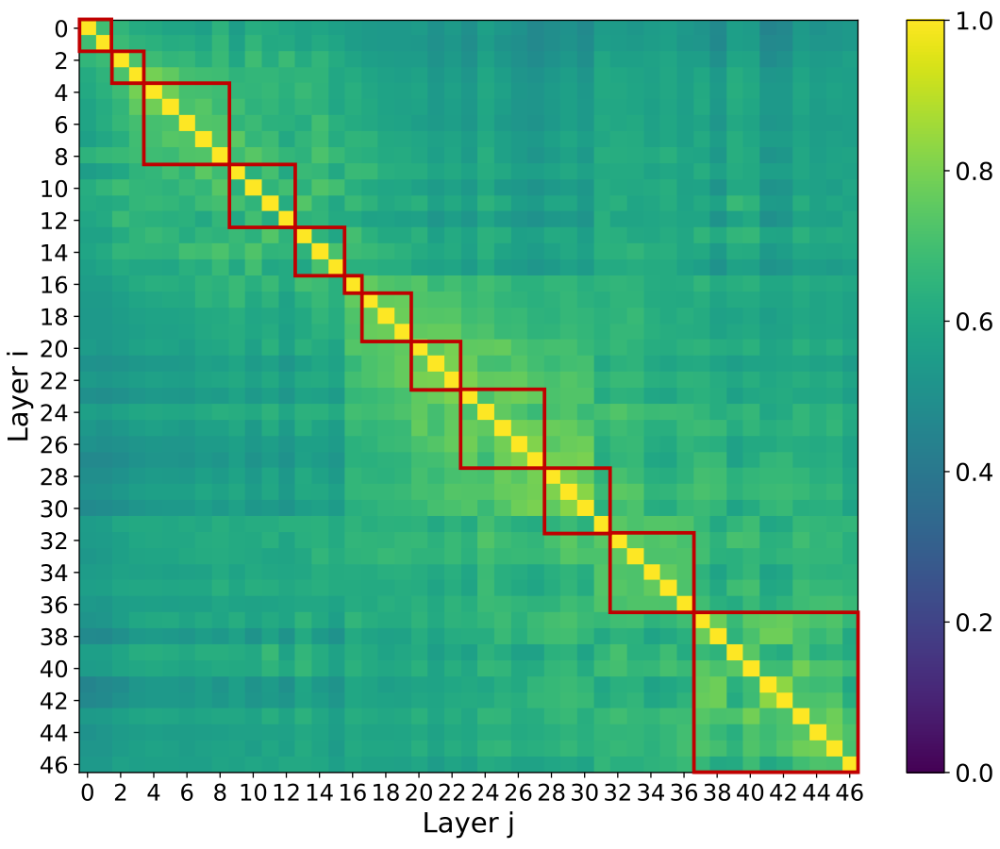

# IndexCache: Accelerating Sparse Attention via Cross-Layer Index Reuse

arXiv 预印本（[arXiv:2603.12201](https://arxiv.org/abs/2603.12201)）。

作者：Yushi Bai¹、Qian Dong¹、Ting Jiang²、Xin Lv²、Zhengxiao Du²、Aohan Zeng¹²、Jie Tang¹、Juanzi Li¹（¹清华大学，²智谱）

## 动机和挑战

DeepSeek Sparse Attention（DSA）在每层用轻量 indexer 选出 top-$k$ 相关 token，将核心注意力复杂度从 $O(L^2)$ 降至 $O(Lk)$，但 indexer 自身仍需在每一层独立执行 $O(L^2)$ 打分。当上下文增至 200K tokens 时，30B 模型中 indexer 耗时已占 prefill 总延迟的 81%，成为长上下文推理的主要瓶颈。既有跨层索引共享方法均依赖全注意力锚点层提供重要度，无法直接用于已完全移除全注意力的 DSA。实证分析表明，DSA 相邻层 indexer 选出的 token 集合同样具有 70% 至 100% 的高度重叠，大部分跨层索引计算均可省去。

## 跨层索引复用机制

如图所示，IndexCache 将模型各层划分为保留自身 indexer 的 Full 层与移除 indexer 的 Shared 层，在逐层推理循环中仅增加一次条件分支。Full 层正常计算当前查询的 top-$k$ 索引并覆写临时缓存，Shared 层直接复用最近前驱 Full 层的缓存索引执行稀疏注意力，不引入额外显存开销。在 30B 模型上仅保留 1/4 层的 indexer 即可省去 75% 的索引计算并保持近无损精度，在 200K 上下文下取得 1.82 倍 prefill 加速与 1.48 倍 decode 加速。

## 跨层重叠特性与局部指标局限

如图所示，各层之间的 top-$k$ 索引重叠率在对角线附近呈分块结构，块边界存在切换焦点的过渡层，浅层与深层关注的子集差异显著。在冻结权重的免训练设定下，均匀间隔保留可能误删关键过渡层而在高压缩比下明显掉点。实验表明，基于跨层注意力输出余弦相似度的动态规划搜索与均匀间隔表现相当，且贪心搜索所得最优共享块与视觉聚类并不重合。原因在于局部重叠率或单层输出相似度只反映平均近似程度，无法刻画少数关键 token 缺失在冻结深层网络中引发的逐层累积误差。

## 免训练贪心层选择

针对已训练好的现成 DSA 模型，免训练 IndexCache 直接以固定校准集上的端到端语言建模损失作为全局代理指标搜索保留模式。算法从全 Full 层配置出发，每步遍历所有候选层试翻转为 Shared 层，并提交使校准损失最小的一次翻转，直至达到目标压缩比例。当模型采用 $P$ 级流水线并行部署时，算法将网络切分为首层固定的 $P$ 个分块并在单步内依次独立翻转，使搜索前向次数缩减约 $P$ 倍。搜索得到的层重要性排序跨不同校准集保持稳定，在 30B 模型与 744B 的 GLM-5 上仅保留 1/4 的 indexer 即可持平基线表现。

## 训练感知的多层注意力蒸馏

当从头或经继续预训练构建 DSA 模型时，训练感知 IndexCache 通过多层注意力蒸馏让保留的 indexer 同时适配后续多个共享层。设保留层 $\ell$ 服务自身及后续 $m$ 个共享层，多目标蒸馏损失定义为各层聚合注意力分布 $\mathbf{p}^{(\ell+j)}_t$ 对第 $\ell$ 层 indexer 输出分布 $\mathbf{q}^{(\ell)}_t$ 的平均 KL 散度：

$$
\mathcal{L}^{\mathrm{I}}_{\mathrm{multi}} = \sum_{j=0}^{m} \frac{1}{m+1} \sum_{t} D_{\mathrm{KL}}\!\left(\mathbf{p}^{(\ell+j)}_t \,\big\|\, \mathbf{q}^{(\ell)}_t\right)
$$

该损失在梯度上等价于拟合所有服务层注意力分布的质心，但实现中只需向后续层传递 $\mathbf{q}^{(\ell)}$，避免了缓存各层注意力分布的显存开销。经预热与稀疏联合训练两阶段优化后，保留的 indexer 学会预测共享块的共识索引，共享层也同步适应继承索引，用均匀 1/4 间隔即可持平完整 DSA。
