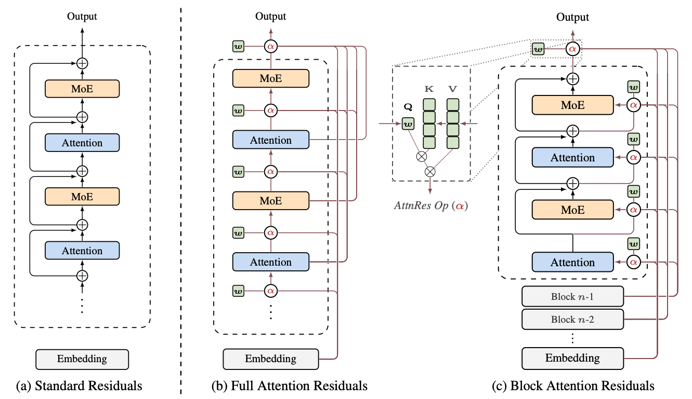
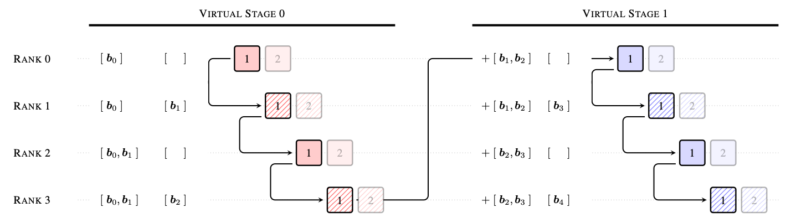
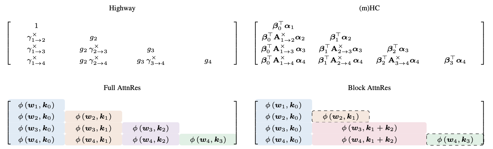

# Attention Residuals

arXiv 技术报告（[arXiv:2603.15031](https://arxiv.org/abs/2603.15031)）。

作者：Kimi Team（月之暗面）

## 动机和挑战

标准 PreNorm 残差连接对所有前序层输出做固定等权累加，导致隐藏状态范数随网络深度线性膨胀并持续稀释单层贡献。深层被迫放大输出才能维持影响，且早期特征被压缩进单一状态后无法被后续层按需检索。

如图所示，标准残差（a）只做均匀累加，Full Attention Residuals（b）对全部前序层输出做注意力加权，Block Attention Residuals（c）则在分块归约后的块表示上做跨层选择。

## Full Attention Residuals

类比 Transformer 用自注意力替代序列维递推，Attention Residuals（AttnRes）用跨层 $\mathrm{softmax}$ 注意力替代深度维的固定残差累加：

$$
\alpha_{i \to l} = \frac{\phi(\boldsymbol{w}_l, \boldsymbol{k}_i)}{\sum_{j=0}^{l-1} \phi(\boldsymbol{w}_l, \boldsymbol{k}_j)}, \qquad \boldsymbol{h}_l = \sum_{i=0}^{l-1} \alpha_{i \to l} \boldsymbol{v}_i
$$

其中 $\boldsymbol{w}_l$ 是第 $l$ 层专属的可学习伪查询向量，$\boldsymbol{k}_i = \boldsymbol{v}_i$ 取词嵌入或前序各层输出，核函数定义为 $\phi(\boldsymbol{w}_l, \boldsymbol{k}_i) = \exp(\boldsymbol{w}_l^\top \mathrm{RMSNorm}(\boldsymbol{k}_i))$。核函数内的 $\mathrm{RMSNorm}$ 防止大范数层主导注意力分布，伪查询全零初始化则使训练初期退化为稳定的等权平均。深度维注意力的算术量很小，但在激活重计算与流水线并行下保留全部 $L$ 层输出仍会产生 $O(Ld)$ 的显存与通信开销。

## Block Attention Residuals

Block AttnRes 将 $L$ 层网络划分为 $N$ 个块并仅对块级表示执行跨层注意力，将显存与跨 stage 通信复杂度从 $O(Ld)$ 降至 $O(Nd)$。每个块内的各层输出通过标准残差求和归约为单一块表示 $\boldsymbol{b}_n = \sum_{j \in \mathcal{B}_n} f_j(\boldsymbol{h}_j)$。各块首层只对词嵌入与已完成块表示计算注意力，块内后续层在此基础上额外关注当前块的演进部分和。实验表明划分为约 8 个块即可恢复 Full AttnRes 的绝大部分收益，在 Scaling Law 上等效带来 $1.25\times$ 的算力增益，并使深层输出范数保持周期性有界、各层梯度分布更加均匀。

## 跨 Stage 缓存流水线训练

如图所示，在交错式流水线并行中，跨 stage 缓存机制在各物理 rank 本地驻留早期虚拟 stage 已接收的块表示，避免每次阶段切换都重复传输完整历史。除首个虚拟 stage 正常累积传递外，后续虚拟 stage 每次跨卡仅发送新增的块表示，使单次转移的峰值通信量缩减为原来的 $1/V$（$V$ 为虚拟 stage 数）。缩减后的增量传输可在稳态 1F1B 调度中与计算完全重叠。配合对跨块注意力做激活重计算，每层保存的激活大小与标准残差完全相同，端到端流水线训练的额外时间开销低于 4%。

## 两阶段推理与序列分片 Prefill

利用伪查询向量与运行时输入解耦的特性，推理引擎通过两阶段计算与序列分片大幅降低访存与长上下文显存占用。第一阶段打包块内各层伪查询，一次性读取历史块完成批处理注意力并返回归一化统计量。第二阶段逐层计算块内部分和注意力，经 online $\mathrm{softmax}$ 与第一阶段结果融合，典型推理延迟开销低于 2%。长序列 prefill 时，系统将块表示沿序列维切分至各张量并行设备，并在通信归约路径中完成合并以消除单卡显存瓶颈。

## 深度混合矩阵与对偶视角

如图所示，从下三角深度混合矩阵视角审视，既有残差变体本质上均为深度维线性注意力，而 AttnRes 实现了深度维 $\mathrm{softmax}$ 注意力。标准残差与门控 Highway 网络对应秩为 1 的半可分矩阵，多流 Hyper-Connections（HC/mHC）则通过流间转移矩阵将混合矩阵扩展为 $m$-半可分结构。这类递推方法受制于有限状态压缩，其跨层权重可分解为查询与键的线性核内积。相比之下，Full AttnRes 通过不可分解的指数核生成满秩的输入相关稠密混合矩阵，Block AttnRes 则在块数与总层数之间平滑调节混合矩阵的有效秩。
