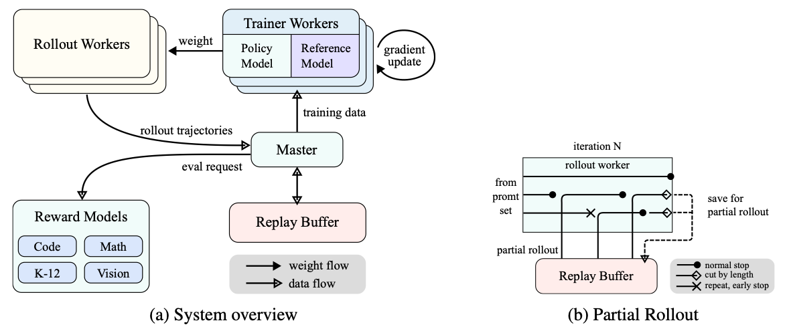
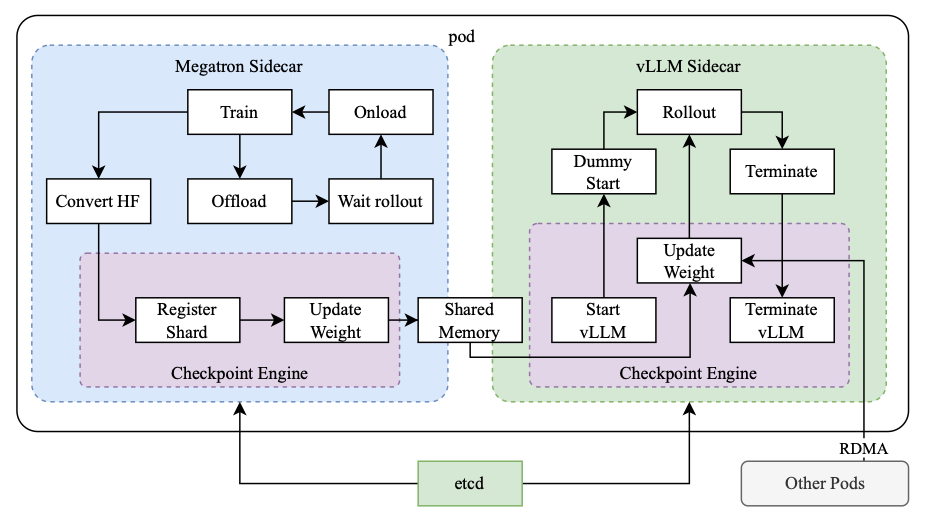

# Kimi k1.5: Scaling Reinforcement Learning with LLMs

arXiv 技术报告（[arXiv:2501.12599](https://arxiv.org/abs/2501.12599)）。

作者：Kimi Team（月之暗面）

## 动机与整体思路

下一词预测预训练受限于高质量静态语料规模，而 RL 允许模型通过奖励驱动的探索自主扩展训练数据。Kimi k1.5 将推理时的树搜索轨迹展平为单个长上下文序列，使模型直接通过自回归生成完成隐式搜索。该设计省去了 Monte Carlo Tree Search（MCTS）、价值网络与过程奖励模型，将多模态 RL 上下文扩展至 128k token。随着上下文增长，模型在文本与视觉联合推理中自发涌现出规划、反思与回溯纠错能力。

## 数据构建与冷启动

高质量 RL 提示集需同时满足领域覆盖广、难度分布均衡与结果可准确验证三项条件。系统利用 SFT 模型的采样通过率自适应评估题目难度，并剔除选择题、判断题及无需推理即可盲猜命中的防作弊样本。编程任务通过自动生成并交叉校验测试用例获取执行反馈，数学任务则采用带推理步骤的奖励模型判别等价答案，视觉数据涵盖真实图表、合成几何与文本渲染图像。进入 RL 前，模型先在小规模高质量图文长思维链（Long-CoT）数据上完成轻量 SFT 冷启动，内化基础推理模式。

## 策略优化与采样

Kimi k1.5 采用基于 Online Mirror Descent 的相对熵正则化策略优化，并舍弃价值网络以保留先出错后自我纠正的有效探索路径。每轮迭代以当前策略 $\pi_{\theta_{i}}$ 为参考策略对问题 $x$ 采样 $k$ 条轨迹，结合经验平均奖励 $\bar{r}$ 按如下梯度更新参数：

$$
\frac{1}{k}\sum_{j=1}^{k}\left(\nabla_{\theta}\log\pi_{\theta}(y_{j},z_{j}\mid x)\bigl(r(x,y_{j},y^{*})-\bar{r}\bigr)-\frac{\tau}{2}\nabla_{\theta}\left(\log\frac{\pi_{\theta}(y_{j},z_{j}\mid x)}{\pi_{\theta_{i}}(y_{j},z_{j}\mid x)}\right)^{2}\right)
$$

其中 $r \in \{0, 1\}$ 为最终答案正确性奖励，$\tau > 0$ 通过对数概率比平方项限制策略偏离以支持离策略样本复用。为抑制训练中回复长度过度增长，系统在预热后对长回复施加组内相对长度惩罚，并结合由易到难的课程采样与低通过率优先采样提升样本效率。

## Long2short 上下文压缩

Long2short 方法旨在将 Long-CoT 模型的推理先验迁移至短思维链（Short-CoT）模型，从而在受限推理 token 预算下提升性能。报告探索了权重平均合并、选取最短正确回复做 SFT 的最短拒绝采样、以短正确回复为正样本的 DPO，以及专门的 Long2short RL 四种方案。其中 Long2short RL 在基础 RL 检查点上施加长度惩罚并大幅收紧最大 rollout 长度，取得了最优的 token 效率。

## 同步 RL 与 Partial Rollout

如图所示，训练系统采用中央 Master 调度的迭代同步架构：(a) Rollout Worker 生成轨迹并经奖励模型评估后写入 Replay Buffer，供 Trainer Worker 更新权重；(b) Partial Rollout 将超长推理轨迹切分为跨迭代片段。单轮超出固定 token 预算的未完成轨迹会暂存至缓冲区并在下一轮续跑，历史片段直接复用而无需从头重采。配合异步 Worker 并发处理短任务与重复序列提前终止机制，系统有效避免了少数长尾轨迹阻塞全局训练。

## 训推混合部署

如图所示，系统在同一 Kubernetes Pod 内以 Sidecar 容器共置 Megatron 与 vLLM，使训练与推理分时共享全部 GPU 以消除等待空闲。训练结束后 Megatron 卸载显存，Checkpoint Engine 在共享内存中转换权重分片并借助 Mooncake 经 RDMA 同步至推理侧。Rollout 完成后系统直接终止 vLLM 进程以彻底释放显存，随后重载 Megatron 进入下一轮训练，并配合轻量容器沙箱支撑高并发代码判题。
