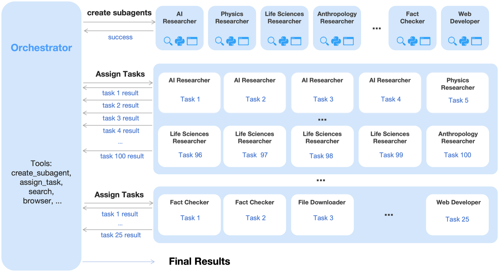
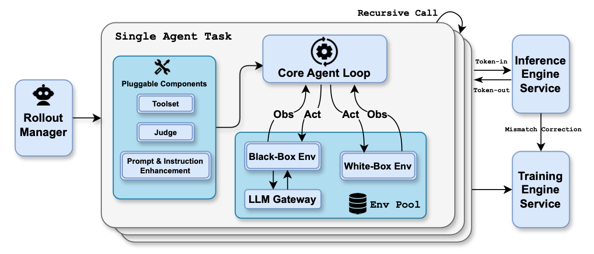

# Kimi K2.5: Visual Agentic Intelligence

arXiv 技术报告（[arXiv:2602.02276](https://arxiv.org/abs/2602.02276)）。

作者：Kimi Team（月之暗面）

## 整体架构

Kimi K2.5 基于总参数 1.04T、激活参数 32B 的 Kimi K2 MoE 主干构建，通过视觉与文本的全流程联合优化推进多模态智能体能力。模型架构由原生分辨率三维视觉编码器 MoonViT-3D、MLP 投影器与语言主干三部分组成。MoonViT-3D 沿用动态分辨率分块打包策略，并将连续四帧图像的视觉块共同展平送入全参数共享的注意力层，使静态图像知识直接迁移至动态视频。进入投影器前的轻量时间池化进一步完成 $4\times$ 时间压缩，使模型在相同上下文窗口内能够处理 $4\times$ 长度的视频输入。

## 原生多模态预训练

在固定多模态总 token 预算下，从预训练早期开始以低比例持续融合视觉数据，效果优于传统的后期高比例集中注入策略。消融实验表明，在训练中后期突然引入高比例视觉数据会冲击已成型的语言表示空间，导致文本能力出现先跌后升的模态迁移震荡。因此，Kimi K2.5 先利用图像与视频字幕生成损失训练 MoonViT-3D 并对齐投影器，随后在约 15T 混合视觉与文本 token 上全程联合预训练视觉编码器与语言主干。最后模型通过长上下文中间训练将序列窗口扩展至 256K，强化长文档与长视频场景下的跨模态推理能力。

## Zero-Vision SFT 与多模态联合 RL

仅使用纯文本轨迹进行 SFT 即可有效激活多模态工具调用能力，而后续的视觉 RL 还能反向提升纯文本基准表现。Zero-Vision SFT 将图像裁剪、二值化与像素统计等操作全部代理为 IPython 代码执行，避开了人工构造的视觉思维链数据多样性不足、易损害泛化的问题。在此冷启动基础上，模型在定位计数、图表文档和视觉 STEM 任务上执行基于结果的视觉 RL，消除忽略图像输入的现象并反向增益纯文本推理。最终的联合多模态 RL 按知识、推理、代码和智能体等能力域而非输入模态组织训练，并结合生成式奖励模型评估开放交互质量。

## Agent Swarm 与并行智能体强化学习

如图所示，Agent Swarm 由可训练的 Orchestrator 动态创建异构专用子智能体并并行拆解子任务，从而突破单智能体串行调用工具的延迟与上下文瓶颈。Parallel-Agent Reinforcement Learning（PARL）在训练中冻结所有子智能体，仅将其返回结果视为环境观测来更新 Orchestrator，规避了多智能体联合优化中的信用分配模糊与训练失稳。PARL 的奖励函数同时约束任务结果与有效并行探索：

$$
r_{\mathrm{PARL}}(x, y) = \lambda_1 r_{\mathrm{parallel}} + \lambda_2 r_{\mathrm{finish}} + r_{\mathrm{perf}}(x, y)
$$

其中 $r_{\mathrm{parallel}}$ 鼓励创建子智能体以防退化回串行执行，$r_{\mathrm{finish}}$ 奖励子任务有效完结以抑制盲目派生的虚假并行，两项辅助权重随训练逐步退火至零。系统按各阶段最慢并发分支决定的关键路径步数约束预算，利用子智能体局部上下文实现分片隔离，最高降低 $4.5\times$ 推理延迟。

## 策略优化与 Toggle 长度控制

为稳定长程多步工具交互训练并兼顾测试时计算效率，Kimi K2.5 结合了双侧概率比截断策略优化与 Toggle 交替预算训练。策略优化直接将新旧对数概率比超出区间的 token 梯度置零，辅以平方正则抑制训推差异导致的离策略漂移。针对刚性长度约束易造成截断过拟合、损害难题高算力推理上限的问题，Toggle 按固定轮次在预算受限阶段与无约束扩展阶段之间交替优化。预算惩罚仅在模型对当前题目的平均准确率达标后才启用，在不损失推理性能的前提下将平均输出长度缩减 25%–30%。

## 训练与强化学习基础设施

训练与强化学习基础设施通过解耦视觉编码与异步协程调度，分别解决多模态流水线负载失衡与大规模智能体交互瓶颈。Decoupled Encoder Process（DEP）先在全卡均摊视觉前向并丢弃中间激活，训练主干后再重算视觉反向，达到纯文本 90% 的训练效率。

如图所示，统一 Agentic RL 框架将每个智能体任务封装为独立异步协程，由 Rollout Manager 并发调度最多 10 万个任务，原生支持子任务递归调用与跨轮次续跑。推理与训练引擎遵循 Token-in-Token-out 协同接口记录全程对数概率以校正训推偏差，并通过统一网关代理仅开放标准 API 的外部黑盒环境。
