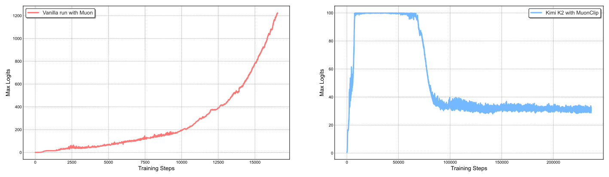
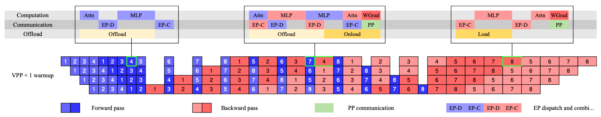
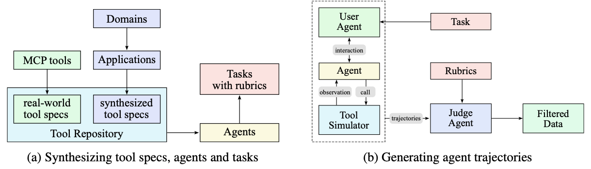

# Kimi K2: Open Agentic Intelligence

arXiv 技术报告（[arXiv:2507.20534](https://arxiv.org/abs/2507.20534)）。

作者：Kimi Team（月之暗面）

## 整体架构与稀疏扩展

Kimi K2 是面向智能体任务设计的开源权重 MoE 模型，总参数量 1.04T，单 token 激活参数量 32B，整体沿用类 DeepSeek-V3 的 MLA 架构。基于 Muon 下的稀疏度 Scaling Law 分析，在固定激活参数量下继续提高总专家数可显著降低达到相同损失所需的训练算力。因此 K2 将稀疏度提升至 48（每层从 384 个路由专家中激活 8 个），同时将注意力头数较 DeepSeek-V3 减半，以降低 128k 长上下文下的推理计算开销。

## MuonClip 优化器与 QK-Clip

如图所示，将 Muon 扩展至大规模 MoE 模型时，满秩更新易推高查询与键矩阵谱范数，使最大注意力 logit 突破 1000 并引发训练发散（左）；引入 MuonClip 后最大 logit 被限制在阈值 $\tau=100$ 内并在中后期自然回落，支撑 15.5T token 预训练全程零 loss spike（右）。由于 MLA 推理时不显式物化键矩阵而无法使用常规键值归一化，QK-Clip 改为根据每头当前 batch 的最大注意力分数按需缩放权重：

$$
S_{\max}^{h}=\frac{1}{\sqrt{d}}\max_{\mathbf{X}\in B}\max_{i,j}\mathbf{Q}_{i}^{h}\mathbf{K}_{j}^{h\top},\qquad \gamma_{h}=\min\!\left(1,\frac{\tau}{S_{\max}^{h}}\right)
$$

当 $S_{\max}^{h}>\tau$ 时，优化器步后仅将该头私有的查询与键内容分量乘以 $\sqrt{\gamma_{h}}$、私有旋转分量乘以 $\gamma_{h}$，保持跨头共享旋转键不变，并在训练稳定后自动退化为零干预。

## 数据重述与分布式预训练

为在有限高质量语料下提升单 token 有效学习信号并避免多轮重复过拟合，K2 对知识与数学语料引入合成重述管线，通过多风格分块自回归改写与语义忠实度校验扩充出 15.5T token 预训练数据。

如图所示，训练系统组合交错式流水线并行、专家并行与 ZeRO-1 数据并行，未采用使参数与梯度显存翻倍的 DualPipe，而是将权重梯度计算从反向传播解耦以掩盖流水线通信。面对万亿模型的激活显存压力，系统结合轻量算子重计算、部分输入仅存储态 FP8 压缩与主机内存流式卸载，实现了计算、通信与卸载的三重重叠。

## 智能体工具调用数据合成

如图所示，SFT 阶段通过三阶段合成管线规模化构建多步工具调用演示：(a) 融合真实 Model Context Protocol（MCP）工具与分层演化的合成工具建立工具库，采样生成异构 Agent 及附带评分量表（rubric）的任务；(b) 由模拟用户、Agent 与维护持久状态的工具模拟器展开多轮交互，再经裁判模型按量表过滤轨迹。针对代码与软件工程场景，管线进一步接入高并发真实容器沙箱，以单元测试结果补充高保真执行反馈。

## 联合强化学习与训推切换

Kimi K2 在统一 RL 框架中结合客观可验证奖励与主观自评量表奖励，将可验证任务覆盖至数学、竞赛编程、复杂指令遵循与上下文忠实度判别。对于开放域主观任务，模型同时担任生成回复的 Actor 与按量表成对排序的 Critic，并利用可验证任务的在线 rollout 持续校准 Critic 的评判标准。训练算法在正则化策略优化基础上引入按任务设定的 token 预算截断惩罚、防遗忘辅助预训练损失与采样温度衰减。基础设施侧通过分布式 Checkpoint Engine 流水化执行主机加载与全量参数广播，在 30 秒内完成万亿参数训推切换，并结合弹性环境服务与 Partial Rollout 支撑长程智能体交互。
