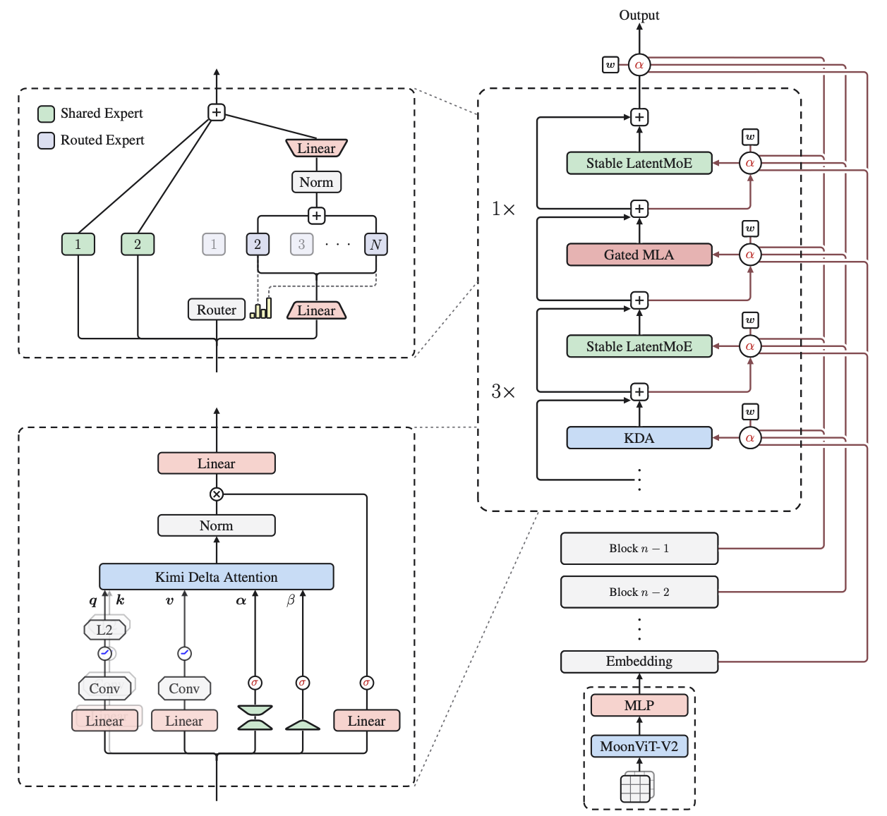
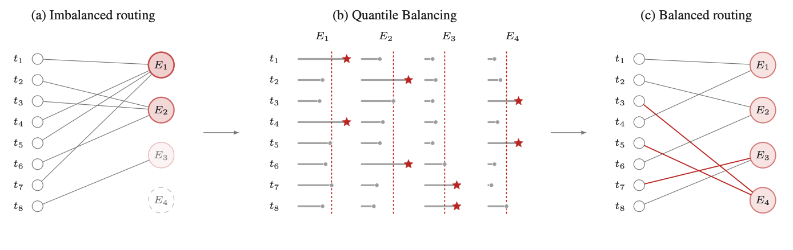
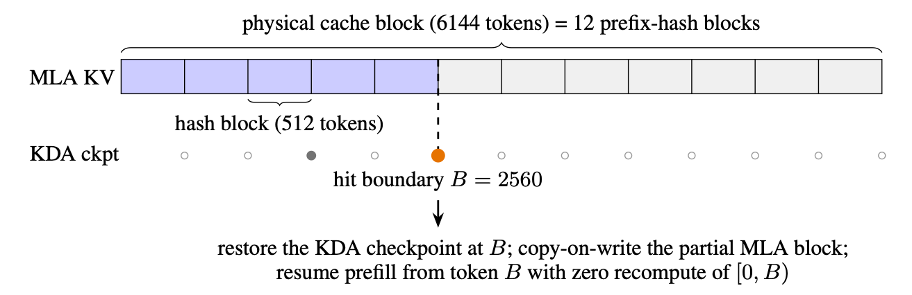

# Kimi K3: Open Frontier Intelligence

arXiv 技术报告（[arXiv:2607.24653](https://arxiv.org/abs/2607.24653)）。

作者：Kimi Team（月之暗面）

## 整体架构

如图所示，Kimi K3 是总参数 2.8T、激活参数 104B 的原生多模态 MoE 模型，支持 1M 上下文窗口，整体 Scaling 效率较 Kimi K2 提升约 $2.5\times$。模型沿序列、深度与宽度三个维度协同扩展信息流：每个基础块按 $3:1$ 比例交错堆叠 Kimi Delta Attention（KDA）与 Gated MLA，跨层则采用 Block Attention Residuals（AttnRes）选择性检索词嵌入和前序块表示。每层注意力后接稀疏度更高的 Stable LatentMoE，视觉输入经原生视觉编码器 MoonViT-V2 与轻量投影器直接进入共享主干。训练采用对注意力投影按头独立正交化动量的 Per-Head Muon 优化器，避免大梯度头主导共享更新方向。

## 混合注意力与无位置编码长上下文

混合注意力通过有下界的通道衰减消除线性注意力的硬件计算瓶颈，并借助无位置编码设计直接外推至 1M 上下文。KDA 在状态矩阵的 delta-rule 更新前施加通道级遗忘门，并改用缩放 Sigmoid 为单步对数衰减设定有限下界，防止分块并行中的倒数重缩放因子超出 BF16 动态范围。由此包括对角块在内的所有因果分块均可统一使用稠密 Tensor Core 矩阵乘，消除了 Kimi Linear 中对角块的逐位置对计算瓶颈。周期性交错的 Gated MLA 移除显式位置编码（No Position Encoding，NoPE），由 KDA 隐式编码位置与近因信息、MLA 负责无约束全局交互，使上下文分阶段扩展至 1M 时无需重调位置编码参数。视觉编码器 MoonViT-V2 同样摒弃对比预训练初始化，从零随主干以 next-token prediction 目标联合训练，消除了接入预训练视觉塔时的梯度尖峰。

## Stable LatentMoE 与分位数负载均衡

Stable LatentMoE 在半宽潜空间中将路由专家池扩展至 896 个、每 token 激活 16 个，并通过归一化、软上限激活与分位数路由稳定极端稀疏训练：

$$
\boldsymbol{u} = \sum_{i \in \mathcal{T}_k(\boldsymbol{x})} p_i E_i^{\mathrm{routed}}(\mathbf{W}^{\downarrow}\boldsymbol{x}), \qquad \boldsymbol{y} = \sum_{j=1}^{N_s} E_j^{\mathrm{shared}}(\boldsymbol{x}) + \mathbf{W}^{\uparrow}\mathrm{RMSNorm}(\boldsymbol{u})
$$

共享专家保持全宽，路由专家降维计算后经 $\mathrm{RMSNorm}$ 上投影，并用软上限激活 Sigmoid Tanh Unit GLU（SiTU-GLU）抑制激活爆炸。

如图所示，针对近千专家下固定步长无辅助损失偏置更新收敛慢或振荡的问题，Quantile Balancing（QB）对偏置分数执行 Top-$(k+1)$ 选择，以第 $k+1$ 大分数作为各 token 的入选截断阈值。QB 将下一轮专家偏置直接解析设为边际分数的目标负载分位数，分布式训练中每步仅需一次分箱直方图归约即可精确均衡全局负载。

## 多推理强度后训练与在线蒸馏

后训练先跨领域、跨推理强度训练专精 RL 策略，再通过多教师在线策略蒸馏汇入统一的量化感知模型。SFT 冷启动后，模型在通用任务、通用智能体与代码智能体三大领域按低、高、最大三档 token 预算开展支持跨轮次 partial rollout 的 RL，共得到 9 个领域与强度专精的教师模型。随后 Multi-Teacher On-Policy Distillation（MOPD）按采样领域 $d$ 与强度 $e$ 计算逐 token 蒸馏奖励，将全部教师能力整合进单一学生策略：

$$
r_{\mathrm{opd}}^d(y_t \mid e, x, y_{< t}) = \mathrm{clip}\!\left(\mathrm{sg}\!\left(\log \frac{\pi_{\mathrm{teacher}}^{(d, e)}(y_t \mid x, y_{< t})}{\pi_\theta(y_t \mid e, x, y_{< t})}\right), -R_{\max}, R_{\max}\right)
$$

其中停止梯度算子 $\mathrm{sg}(\cdot)$ 与截断阈值 $R_{\max}$ 限制极端优势信号以维持长轨迹训练稳定。后训练全程对路由专家权重开启 MXFP4 量化感知训练以消除训推失配，同时将 MTP 层微调为投机解码草稿模型。

## KDA 并行与 3T 级预训练系统

预训练系统围绕 KDA 串行状态依赖与 2.8T 稀疏参数规模，协同设计了序列并行、完全均衡专家并行与分级显存管理。单卡算子 FlashKDA 重叠块内计算与跨块传递，跨卡 KDA Context Parallelism（KCP）则通过本地计算局部状态与转移矩阵，经一次定长通信恢复入站状态。专家并行方案 MoonEP 动态规划迁移至多 $E/R$ 个冗余专家，保证各卡接收相等数量的 token，实现定长零拷贝通信与无主机同步执行。显存与多模态侧统一对激活施加低精度量化和跨流水线远端卸载，将分片梯度卸载至 CPU，并把大部分视觉编码计算隐藏进流水线气泡。

## 百万上下文 RL 与在线推理服务

长程 RL 与在线服务通过跨介质状态池化、微虚拟机沙箱和混合注意力前缀缓存，支撑 1M 上下文下的训练与推理。同驻 RL 仅在淘汰空闲前缀时将 KDA 状态与 MLA KV 写回 CPU 内存池，并用微虚拟机沙箱 AgentENV 实现增量快照与零资源暂停。

如图所示，在线服务在统一分页池中解耦物理分配块与前缀哈希块，在稀疏哈希边界保存 KDA 检查点以实现细粒度命中和零重算 prefill。投机解码被拒时仅重放草稿投影输入以片上恢复 KDA 状态，集群层则结合主备缓存亲和路由与预算准入控制保障延迟稳定。
