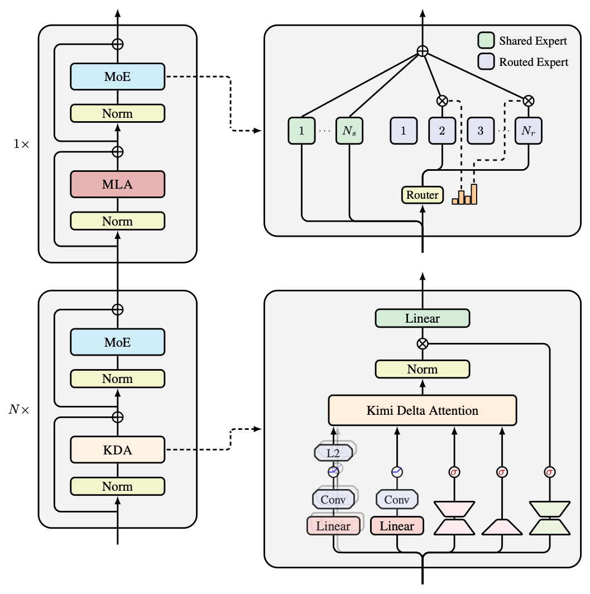

# Kimi Linear: An Expressive, Efficient Attention Architecture

arXiv 技术报告（[arXiv:2510.26692](https://arxiv.org/abs/2510.26692)）。

作者：Kimi Team（月之暗面）

## 动机与混合架构

如图所示，针对智能体长程交互与 RL 测试时扩展下全注意力二次计算复杂度与 KV Cache 膨胀瓶颈，Kimi Linear 按固定 3:1 比例交替堆叠 3 层线性 Kimi Delta Attention（KDA）与 1 层全局 MLA，每层后接 MoE 通道混合层。纯线性注意力受限于固定状态容量而难以完成长距离精确检索，层内异构头混合又会增加分布式并行与调度复杂度。规则的 3:1 层间混合直接削减高达 75% 的 KV Cache 占用，旗舰模型总参数量 48B、激活参数量 3B，最长支持 1M token 上下文。

## Kimi Delta Attention 与细粒度门控

Gated DeltaNet 在重构损失在线梯度下降的基础上引入标量遗忘门，但每头共用单一衰减率限制了对有限状态记忆的精细调控。KDA 将遗忘门细化为通道级对角矩阵 $\operatorname{Diag}(\boldsymbol{\alpha}_{t})$，为每个特征维度独立分配遗忘速率：

$$
\mathbf{S}_{t}=\left(\mathbf{I}-\beta_{t}\mathbf{k}_{t}\mathbf{k}_{t}^{\top}\right)\operatorname{Diag}(\boldsymbol{\alpha}_{t})\mathbf{S}_{t-1}+\beta_{t}\mathbf{k}_{t}\mathbf{v}_{t}^{\top},\qquad \mathbf{o}_{t}=\mathbf{S}_{t}^{\top}\mathbf{q}_{t}
$$

其中 $\mathbf{S}_{t}$ 为矩阵循环记忆状态，$\beta_{t}$ 为学习率门控，查询与键经短卷积、激活与归一化以保障特征值稳定。通道衰减门与输出侧的数据依赖 $\operatorname{Sigmoid}$ 门均采用低秩投影参数化，在不增加参数开销的前提下有效缓解 Attention Sink。

## 分块并行算法与受限 DPLR

为在训练和 prefill 阶段充分利用 Tensor Core 矩阵乘吞吐，KDA 将序列切分为定长分块，通过紧凑 WY 表示与下三角前向代换变换折叠块内连乘更新，实现块间循环递推与块内并行计算：

$$
\mathbf{O}_{[t]}=\left(\boldsymbol{\Gamma}_{[t]}^{1\rightarrow C}\odot\mathbf{Q}_{[t]}\right)\mathbf{S}_{[t]}+\operatorname{Tril}\!\left(\left(\boldsymbol{\Gamma}_{[t]}^{1\rightarrow C}\odot\mathbf{Q}_{[t]}\right)\left(\frac{\mathbf{K}_{[t]}}{\boldsymbol{\Gamma}_{[t]}^{1\rightarrow C}}\right)^{\top}\right)\left(\mathbf{U}_{[t]}-\mathbf{W}_{[t]}\mathbf{S}_{[t]}\right)
$$

其中 $\boldsymbol{\Gamma}_{[t]}^{1\rightarrow C}$ 为块内累积通道衰减，$\mathbf{W}_{[t]}$ 与 $\mathbf{U}_{[t]}$ 为变换后的辅助矩阵，两项分别对应跨块状态读取与块内并行注意力。相比通用 Diagonal-Plus-Low-Rank（DPLR）转移矩阵需在对数域执行四项全精度二级分块，KDA 将低秩项绑定至键向量 $\mathbf{k}_{t}$，省去一半二级分块与三次矩阵乘法，使算子速度提升约一倍。

## 隐式位置编码与全局层 NoPE

展开递推式可知，KDA 在查询与历史键之间累乘数据依赖的状态转移矩阵，等价于一种放宽正交旋转约束的可学习乘法位置编码，并借由通道级独立衰减提供多尺度相对位置与近因偏置。基于此，Kimi Linear 对所有全局 MLA 层采用无位置编码（No Position Encoding，NoPE），将位置感知职责完全交由 KDA 层承担。该设计消除了全局层显式 RoPE 与线性层隐式位置偏置之间的跨层失配，省去了长上下文扩展时的基频调优，并允许 MLA 在推理时直接转换为纯 Multi-Query Attention（MQA）。

## 训练扩展与长上下文推理效率

算力最优 Scaling Law 实验显示，无需额外重调超参数的 3:1 混合 Kimi Linear 相比全注意力 MLA 具备约 1.16 倍的等效算力效率优势。预训练与后训练沿用 MuonClip 优化器与多阶段 SFT，并在可验证奖励 RL 中引入截断重要性采样以消除训推精度差异导致的策略偏移。在计算开销上，单头 KDA 的训练与 prefill 复杂度随序列长度严格线性增长，推理 prefill 阶段调用分块并行算子（1M 序列下较 MLA 提速 2.9 倍），自回归 decode 阶段则切换为仅维护固定大小状态的循环算子。结合 75% 的 KV Cache 缩减所释放的更大并发 batch 空间，Kimi Linear 在 1M 上下文下实现了最高 6.3 倍的解码吞吐提升，且算子已集成至 vLLM 可原位替换全注意力架构。
