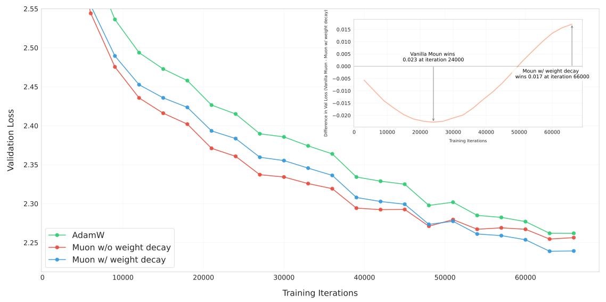
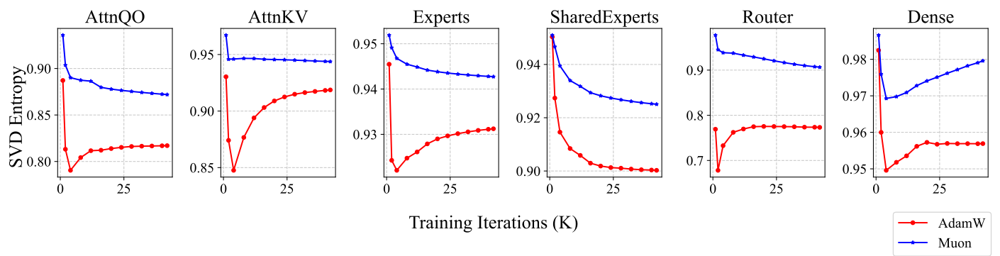

# Muon is Scalable for LLM Training

arXiv 预印本（[arXiv:2502.16982](https://arxiv.org/abs/2502.16982)）。

作者：Jingyuan Liu¹、Jianlin Su¹、Xingcheng Yao²、Zhejun Jiang¹、Guokun Lai¹、Yulun Du¹、Yidao Qin¹、Weixin Xu¹、Enzhe Lu¹、Junjie Yan¹等 28 位作者（¹月之暗面，²UCLA）

## 动机与矩阵正交化

基于矩阵正交化的 Muon 优化器在小规模语言模型上收敛更快，但扩展至十亿级参数与万亿 token 时面临数值发散和分布式计算开销等挑战。Muon 在每步更新时对梯度动量矩阵执行 5 步五次多项式 Newton-Schulz 迭代，近似计算其正交因子而无需显式奇异值分解。从范数约束下的最速下降视角看，正交化对应于矩阵诱导谱范数约束，可避免参数仅沿少数主导方向更新。

## 权重衰减与更新尺度对齐

如图所示，原始 Muon 虽在前期收敛更快，但在长周期过训练下权重幅度持续膨胀并超出 BF16 高精度区间，引入解耦权重衰减后才能在后期持续优于原始版本与 AdamW。此外，形状为 $[A, B]$ 的满秩矩阵经正交化后的理论更新均方根（Root Mean Square，RMS）为 $\sqrt{1/\max(A, B)}$，会导致不同形状层的更新幅度失衡。作者按矩阵维度补偿该因子并将更新幅度对齐至 AdamW 的经验区间，得到统一更新规则：

$$
\mathbf{W}_{t}=\mathbf{W}_{t-1}-\eta_{t}\bigl(0.2\cdot\mathbf{O}_{t}\cdot\sqrt{\max(A,B)}+\lambda\mathbf{W}_{t-1}\bigr)
$$

其中 $\mathbf{O}_{t}$ 为正交化动量，$\eta_{t}$ 与 $\lambda$ 为学习率和权重衰减系数，使矩阵参数上的 Muon 可与非矩阵参数上的 AdamW 直接共享超参数。

## 分布式实现与算力效率

标准 ZeRO-1 按元素切分优化器状态，无法直接执行依赖完整梯度矩阵的 Newton-Schulz 迭代。Distributed Muon 沿用数据并行切分主权重与单份动量缓冲，在本地更新动量分片后，仅对当前设备负责的参数分片执行一次 BF16 收集以拼出完整矩阵完成正交化，随后丢弃非本地更新分片。相比分布式 AdamW，该方案将优化器显存减半，总通信量控制在 1.25 倍以内，端到端训练延迟几乎无增加。算力最优 Scaling Law 实验表明，Muon 仅需约 52% 的训练 FLOPs 即可达到 AdamW 同等损失（约 2 倍计算效率）。作者据此在类 DeepSeek-V3-Small 的 MoE 架构上用 5.7T token 预训练出 3B 激活、16B 总参数的 Moonlight 模型，全程未出现损失尖峰并推进了性能与训练算力的 Pareto 前沿。

## 奇异值谱动态与微调特性

如图所示，在注意力投影、专家网络、MoE 路由器与稠密层六组权重中，Muon 训练全程均保持高于 AdamW 的奇异值熵，其中路由器权重的优势最为显著。超过 90% 的权重矩阵呈现出更平坦的奇异值分布，印证了正交化能够驱动参数探索更多样化的更新方向。在 SFT 阶段，预训练与微调均使用 Muon 时效果最佳，而中途在 AdamW 与 Muon 之间切换则会因优化器失配而削弱收益。
