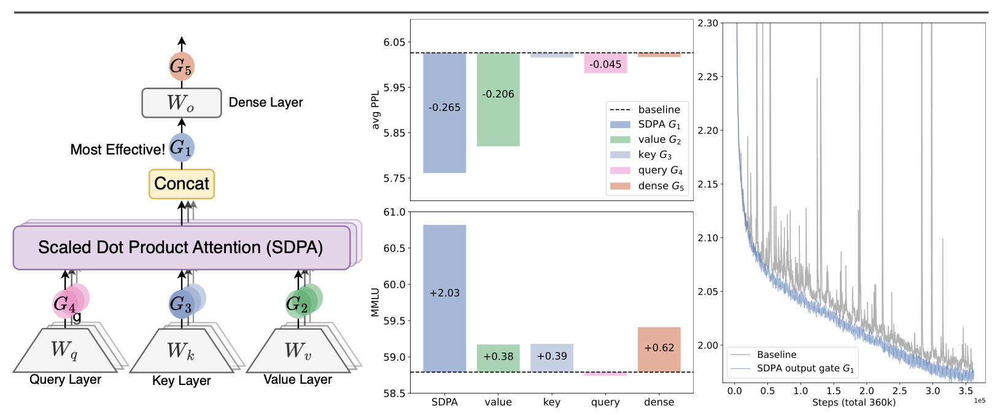
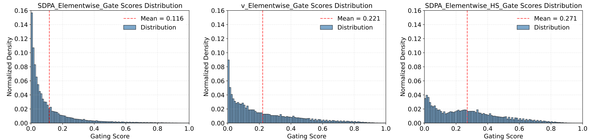
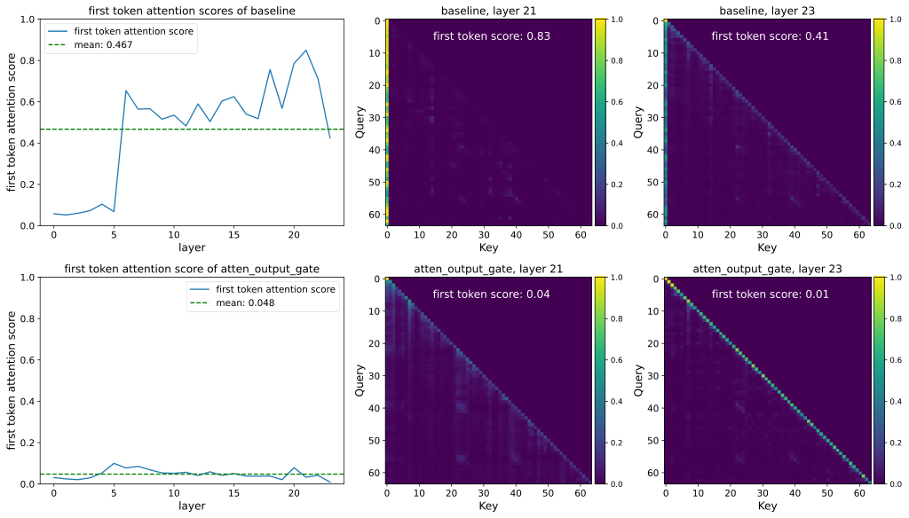

# Gated Attention for Large Language Models: Non-linearity, Sparsity, and Attention-Sink-Free

发表于 NeurIPS '25（[arXiv:2505.06708](https://arxiv.org/abs/2505.06708)）。

作者：Zihan Qiu¹、Zekun Wang¹、Bo Zheng¹、Zeyu Huang²、Kaiyue Wen³、Songlin Yang⁴、Rui Men¹、Le Yu¹、Fei Huang¹、Suozhi Huang⁵、Dayiheng Liu¹、Jingren Zhou¹、Junyang Lin¹（¹阿里巴巴，²University of Edinburgh，³Stanford University，⁴MIT，⁵清华大学）

## 门控注意力设计与训练稳定性

如图所示，作者在 15B MoE（激活 2.54B）与 1.7B 稠密模型上系统对比了注意力层的五种门控位置，发现在 Scaled Dot-Product Attention（SDPA）输出端（$G_1$）施加头特定的乘法 sigmoid 门控效果最优。该改动仅带来不到 2% 的延迟开销，却显著提升下游表现，并在 3.5T token 训练中消除 loss spike、支持翻倍学习率稳定收敛。门控操作统一定义为：

$$
Y^{\prime} = Y \odot \sigma(X W_\theta)
$$

其中 $Y$ 为待调制的注意力层中间张量，$X$ 为当前 token 归一化后的隐藏状态，$W_\theta$ 为可学习门控参数。相比在查询、键、值投影后（$G_4, G_3, G_2$）或输出层后（$G_5$）加门控，$G_1$ 位置的头独立调制在性能与训练扩展性上均取得最大收益。

## 低秩映射的非线性增强

门控在 $G_1$ 与 $G_2$ 位置有效的首要原因，是打破了注意力头内部连续线性变换的低秩瓶颈。展开第 $k$ 个注意力头对第 $i$ 个 token 的输出可得：

$$
o_i^k = \sum_{j=0}^{i} S_{ij}^k X_j (W_V^k W_O^k)
$$

由于单头维度小于模型隐藏维度，值投影 $W_V^k$ 与输出投影 $W_O^k$ 的连续乘积退化为一个低秩线性变换，而 GQA 中同组共享 $W_V$ 会进一步限制表达能力。在值投影后（$G_2$）或 SDPA 输出后（$G_1$）插入门控，本质上是在 $W_V^k$ 与 $W_O^k$ 之间引入非线性映射，而在 $W_O$ 之后的 $G_5$ 位置加门控无法改变该低秩结构，因此几乎没有增益。

## 查询相关的头特定稀疏性

如图所示，SDPA 逐元素门控（$G_1$）的平均门控分数仅为 0.116 且高度集中于 0 附近，稀疏性明显强于值门控（$G_2$）与跨头共享门控。这是因为 $G_1$ 门控由当前查询 token 的隐藏状态计算，并按注意力头独立调制，能够针对当前查询动态滤除无关的聚合上下文。相反，$G_2$ 门控仅依赖历史键值侧输入，跨头共享、输入无关门控或限制最小门控值的非稀疏激活都会削弱这种针对性过滤，导致性能下降。

## 消除 Attention Sink 与异常激活

如图所示，标准 Softmax 归一化迫使冗余注意力集中在首 token 上形成 attention sink，基线模型首 token 平均注意力占比达 46.7%，引入 $G_1$ 门控后降至 4.8%。同时，稀疏门控将各层隐藏状态的平均最大激活值从 1,053 压低至 94，减少了低精度训练中的数值误差与不稳定现象。对比实验显示，仅在值投影处加门控虽同样压低了异常大激活，却仍保留较高的首 token 注意力占比，表明异常大激活并非产生 attention sink 的必要条件。

## 长上下文外推

消除 attention sink 直接增强了模型对长上下文免训练外推的适应能力。基线模型依赖首 token 的 attention sink 调节注意力分布，当使用 YaRN 修改 RoPE 频率将上下文从 32K 外推至 128K 时，原有 sink 模式难以免训练自适应，导致性能大幅退化。而 SDPA 输出门控模型依靠输入相关的门控分数动态控制信息流，在 RULER 基准的 64K 与 128K 长度下较基线提升近 30 分，并显著减轻了原 32K 长度范围内的性能损失。
