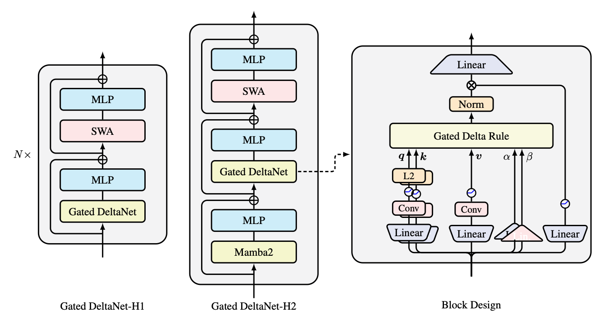

# Gated Delta Networks: Improving Mamba2 with Delta Rule

发表于 ICLR '25（[arXiv:2412.06464](https://arxiv.org/abs/2412.06464)）。

作者：Songlin Yang¹、Jan Kautz²、Ali Hatamizadeh²（¹MIT CSAIL，²NVIDIA）

## 动机和挑战

线性 Transformer 将历史上下文压缩为固定维度的键值状态矩阵以实现线性复杂度推理，但在长序列下容易因容量受限产生记忆冲突。现有两类改进机制在记忆管理上各有短板：Mamba2 引入标量门对全部历史键值关联做无差别均匀衰减，无法区分信息重要程度，损害长距离精确保持能力。DeltaNet 利用 delta 规则定向擦除并重写当前键对应的旧值，擅长精确关联召回，但每步仅更新单个键值对，在上下文切换时无法快速清空成批过期信息。

## Gated Delta 更新规则

Gated DeltaNet 观察到门控衰减与 delta 规则在记忆管理上天然互补，将二者统一为如下更新规则：

$$
\mathbf{S}_t = \mathbf{S}_{t-1}\big(\alpha_t(\mathbf{I} - \beta_t \mathbf{k}_t \mathbf{k}_t^\top)\big) + \beta_t \mathbf{v}_t \mathbf{k}_t^\top
$$

其中依赖输入的 $\alpha_t \in (0, 1)$ 控制整体状态衰减，$\beta_t \in (0, 1)$ 控制当前键 $\mathbf{k}_t$ 的写入强度。当 $\alpha_t \to 0$ 时模型可迅速清空过期上下文避免状态饱和，当 $\alpha_t \to 1$ 时则退化为纯 delta 规则精准替换单个键值关联。从在线学习与测试时回归视角看，隐藏状态相当于快速权重，该规则等价于在单步梯度下降更新中加入自适应权重衰减。在大海捞针（S-NIAH）检索分析中，这一设计同时克服了 Mamba2 遗忘过快与 DeltaNet 真实长文记忆叠加冲突的问题。

## 分块并行训练算法

由于逐步递推无法充分利用现代 GPU 算力，Gated DeltaNet 将门控衰减项融入基于 WY 表示与 UT 变换的分块并行算法。算法将输入序列切分为固定长度的 chunk，在分块内部把广义 Householder 转移矩阵与累积衰减因子的连乘改写为稠密矩阵乘法，从而高效调用 Tensor Core 并行计算。分块之间仅顺序传递紧凑的状态矩阵，既保持了序列长度的线性时间复杂度，又使单卡训练吞吐率与原始 DeltaNet 基本持平。

## 模块设计与混合架构

如图所示，右侧为 Gated DeltaNet 的 token mixer 模块，查询、键、值经线性投影、短卷积与 SiLU 激活生成，并对查询和键做 $L_2$ 归一化以保证训练稳定。状态更新结果经归一化与乘法门控后由线性层输出，整体宏观结构沿用交替堆叠 token mixer 与 SwiGLU 前馈层的范式。由于固定维度循环状态在局部偏移建模与精确检索上仍不及精确注意力，作者在层间交替引入窗口为 2K 的 Sliding Window Attention（SWA）构建混合架构。其中 Gated DeltaNet-H1 交替堆叠 Gated DeltaNet 与 SWA 层，Gated DeltaNet-H2 进一步组合 Mamba2、Gated DeltaNet 与 SWA 层，兼顾了更高训练吞吐率与长上下文检索能力。
