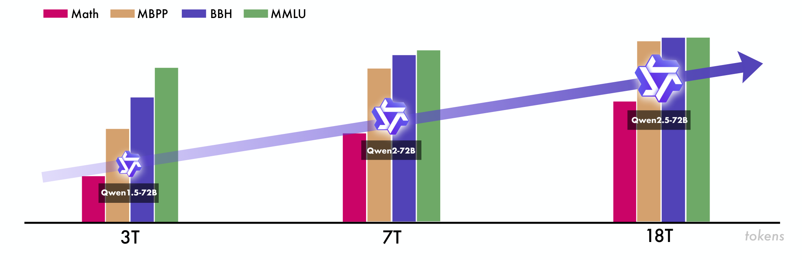
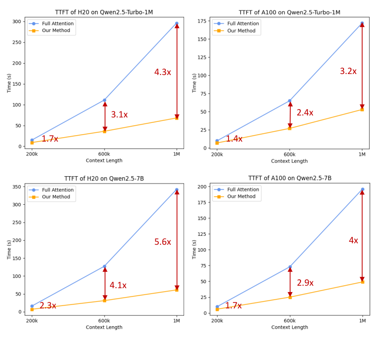

# Qwen2.5 Technical Report

arXiv 技术报告（[arXiv:2412.15115](https://arxiv.org/abs/2412.15115)）。

作者：Qwen Team（阿里巴巴）

## 模型系列与架构

Qwen2.5 同时提供开源稠密模型与商用 API MoE 模型，覆盖从端侧到旗舰的完整规模梯度。稠密模型参数规模从 0.5B 扩展至 72B，补齐了高性价比的中小尺寸档位；MoE 模型则包括 Qwen2.5-Turbo 与 Qwen2.5-Plus。架构上，稠密模型延续基于 GQA、SwiGLU、RoPE 与 Pre-RMSNorm 的 Transformer 解码器设计。MoE 模型将标准前馈网络替换为细粒度专家切分与共享专家路由结构，全系列共享统一词表并扩充了工具调用等控制 token。

## 预训练数据构建

如图所示，Qwen 系列将预训练语料从 3T、7T 扩展至 Qwen2.5 的 18T token，持续提升通用知识、编程与数学推理表现。为兼顾规模与质量，团队使用指令模型对多语种语料做多维打分过滤，并融入 Qwen2.5-Math 与 Qwen2.5-Coder 的领域预训练数据。针对复杂推理需求，团队进一步合成数学、代码与知识样本，再经专用奖励模型严格筛除低质数据。同时，语料配比下调了电商与社交等高重复领域权重，上调科技与学术等高信息密度内容占比。

## 超参数扩展律

Qwen2.5 建立了面向训练超参数的扩展律，用于预测不同架构与规模下的最优学习率和 batch 大小。不同于仅在固定算力预算下求解最优模型尺寸的传统方法，该扩展律系统刻画了模型规模、数据量与最终训练损失之间的定量关系。团队据此为各尺寸稠密模型设定训练配置，并指导 MoE 模型的总参数与激活参数配比，使其以更低成本匹配目标稠密模型的性能。

## 长上下文训练与推理加速

如图所示，Qwen2.5 引入基于 MInference 的动态稀疏注意力降低长序列 prefill 延迟，将 1M token 序列的注意力计算量降至原来的 1/12.5，使 Qwen2.5-Turbo 的 Time To First Token（TTFT）获得 3.2 至 4.3 倍加速。训练上，常规模型在预训练末期将序列长度扩展至 32K，Qwen2.5-Turbo 则分四阶段渐进扩展至 256K，并在后训练中混合长短指令微调。推理阶段结合 YaRN 与 Dual Chunk Attention（DCA）实现 4 倍免训练长度外推，使常规模型支持 128K、Qwen2.5-Turbo 支持最高 1M 上下文。

## 监督微调

Qwen2.5 构建了超过 100 万条高质量样本进行 SFT，将单次最大生成长度从 2K 提升至 8K token。微调数据重点补齐了长文本生成、结构化表格理解、多语种迁移与复杂指令遵循等能力。其中数学与代码数据分别引入拒绝采样推理链和多语言沙箱单元测试验证，指令遵循样本则通过自动生成校验代码与执行反馈严格过滤。所有候选回复最终经专用评判模型与多智能体协同打分，仅保留各维度均无缺陷的样本。

## 两阶段强化学习

Qwen2.5 采用离线 RL 与在线 RL 两阶段对齐策略，分别优化客观可验证能力与主观人类偏好。离线阶段面向数学、编程与逻辑推理等有客观标准但奖励模型难以评估的任务，借助执行反馈与答案匹配构造正负偏好对执行 DPO 训练。在线阶段基于真实性、有用性与无害性等准则训练奖励模型，再使用 GRPO 对每个问题采样多条回复更新策略。训练时优先调度奖励分数方差更大的问题，从而提升在线探索的学习效率。
