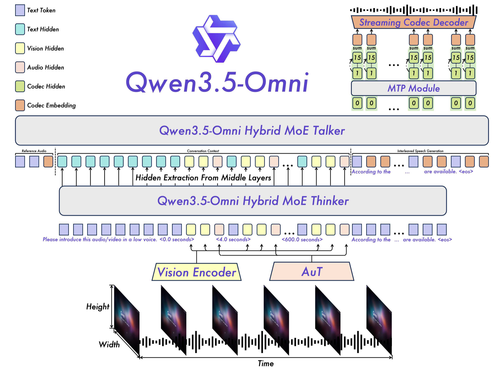
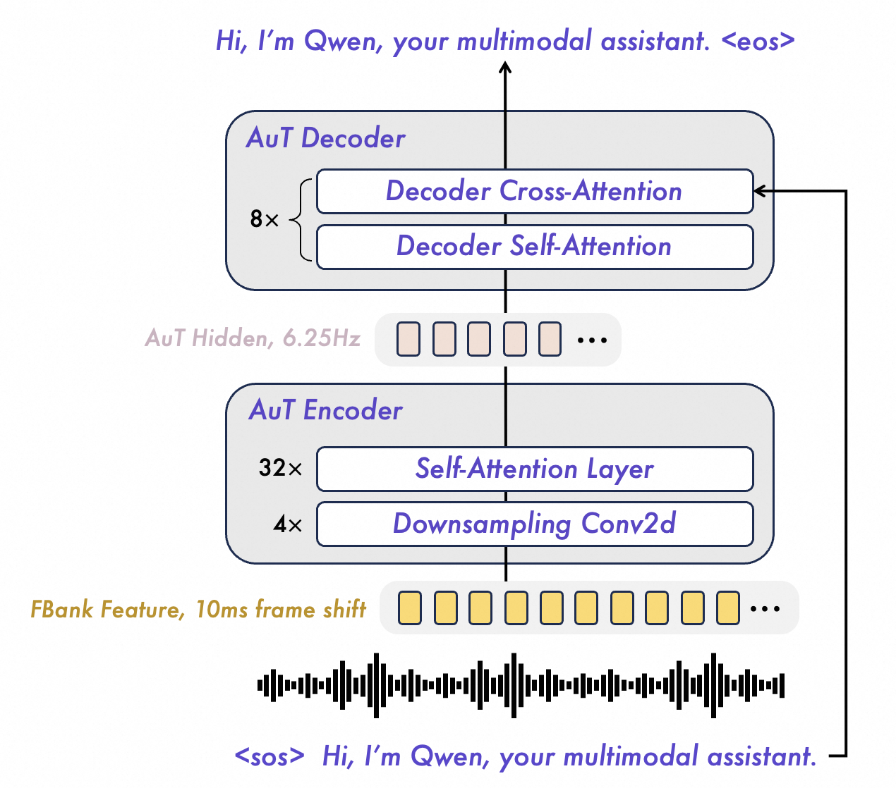

# Qwen3.5-Omni Technical Report

arXiv 技术报告（[arXiv:2604.15804](https://arxiv.org/abs/2604.15804)）。

作者：Qwen Team（阿里巴巴）

## 整体架构

如图所示，Qwen3.5-Omni 延续 Thinker-Talker 双模块架构，并将二者统一升级为引入 Gated DeltaNet 的混合注意力 MoE 网络，支持 256K 长上下文全模态理解与实时语音交互。Thinker 接收文本及经视觉与音频编码器处理的交错多模态序列，在自回归生成文本的同时将中间层隐藏状态流式传递给 Talker。Talker 结合对话上下文预测多码本语音 token，每步由轻量级 MTP 模块补全当前帧残差码本，再经因果卷积网络 Code2Wav 逐帧合成波形。依托编码器分块预填充与 Gated DeltaNet 对 KV Cache 访存开销的削减，模型在长序列与并发服务下仍保持百毫秒级首包延迟。

## 多模态感知与音频编码

如图所示，从头训练的 Audio Transformer（AuT）基于注意力编码器-解码器结构，通过二维卷积 16 倍下采样与自注意力层将梅尔频谱压缩为 6.25 Hz 的音频表示。编码器引入动态注意力窗口训练机制，以兼顾实时流式 prefill 缓存与离线长音频理解。在音视频时序对齐上，模型利用多模态位置编码将音频与动态采样视频帧锚定到统一时间分辨率，并令跨模态位置编号连续递增。为避免长视频绝对时间编号过于稀疏，模型在音视频时间片前插入秒级显式文本时间戳，并在音频流中随机插入时间戳以增强长程对齐。

## 流式语音生成与 ARIA 对齐

针对文本与语音分词速率不一致引发的流式合成跳词、错读与数字播报歧义，Talker 提出 Adaptive Rate Interleave Alignment（ARIA），将传统双轨生成改造为单流交错建模。ARIA 不依赖外部强制对齐工具或固定交错比例，而是要求任意生成前缀的累计语音与文本 token 比值不超过整句全局比值。这一自适应单调速率约束既消除了双轨同步开销，又天然适配不同编码效率的语种并支持任意文本前缀下的平滑语音续写。此外，Talker 引入编码了文本描述与参考音频序列的专用系统提示词，无需固定说话人嵌入即可实现零样本声音克隆及韵律、音量与情感的细粒度控制。

## 三阶段预训练

Qwen3.5-Omni 从预训练早期即混合单模态与跨模态语料，按编码器对齐、通用多模态与长上下文三个阶段递进训练。编码器对齐阶段基于 Qwen3.5 与 AuT 初始化各模块，冻结语言主干，按先适配器后编码器的顺序在大规模图文和音文对上独立训练两个模态编码器。通用多模态阶段解冻全部参数，在 32K 序列长度与约 4T 多模态 token 上联合训练图像、视频、音频与文本理解任务。长上下文阶段进一步将最大序列长度扩展至 256K，同时提高长音频与长视频样本占比以强化长程跨模态建模。

## Thinker 与 Talker 后训练

后训练分别针对 Thinker 与 Talker 设计多阶段对齐管线，以兼顾全模态能力保持与真实对话体验。Thinker 先在文本、视觉和音频领域独立训练专家教师模型并蒸馏至统一基座，再通过 On-Policy Distillation（OPD）将同查询下更高质的文本条件回复蒸馏给语音提问分支。随后 Thinker 执行交互对齐 RL，消除长程多轮对话中的语码混用、人设漂移与指令退化。Talker 先在大规模上下文语音数据上完成通用训练，再经高质量数据持续预训练抑制噪声幻觉并将上下文扩展至 64K。最后 Talker 结合偏好优化、规则奖励与轻量级说话人微调，实现自然的跨语种音色迁移。
