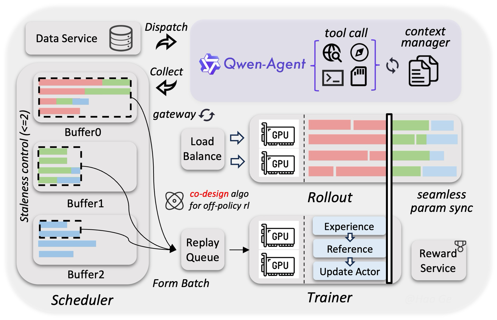

# Qwen3.5: Towards Native Multimodal Agents

来源：[官方博客](https://qwen.ai/blog?id=qwen3.5)。

作者：Qwen Team（阿里巴巴）

## 混合架构与原生多模态预训练

Qwen3.5 将 Qwen3-Next 的混合注意力与高稀疏 MoE 架构扩展至原生多模态基座，首款开放模型总参数 397B、单次前向激活 17B 参数。在 256K 上下文下，其 decode 吞吐达到上代旗舰 Qwen3-Max 的 19 倍。预训练采用早期文本与视觉融合策略，在严格过滤的图文、视频、推理与多语言语料上联合训练，并扩大词表以提升多语言编解码效率。

## 异构多模态与原生 FP8 训练

为消除视觉与语言模块联合训练的计算瓶颈，Qwen3.5 采用并行策略解耦的异构训练基础设施。系统利用稀疏激活实现跨组件计算重叠，在图文视频混合数据上取得接近纯文本基线的训练吞吐。训练管线同时引入原生 FP8 方案加速激活、路由与矩阵乘运算，并通过运行时监控在敏感层保留 BF16 精度，使激活显存降低约一半并带来逾 10% 的训练加速。

## 异步强化学习框架

如图所示，Qwen3.5 构建了训推完全解耦的异步 RL 框架，以支撑大规模多轮多模态智能体环境的并发交互。Qwen-Agent 采集多轮工具交互轨迹并交由 Scheduler 对多级缓冲区执行陈旧度控制，再组装批次送入回放队列。解耦的 Rollout 集群经动态负载均衡生成轨迹，Trainer 结合奖励服务更新策略并与推理端无缝同步参数。配合端到端 FP8 训练、路由回放与多轮 rollout 锁定等一致性设计，整套框架实现了 3 至 5 倍端到端加速。
