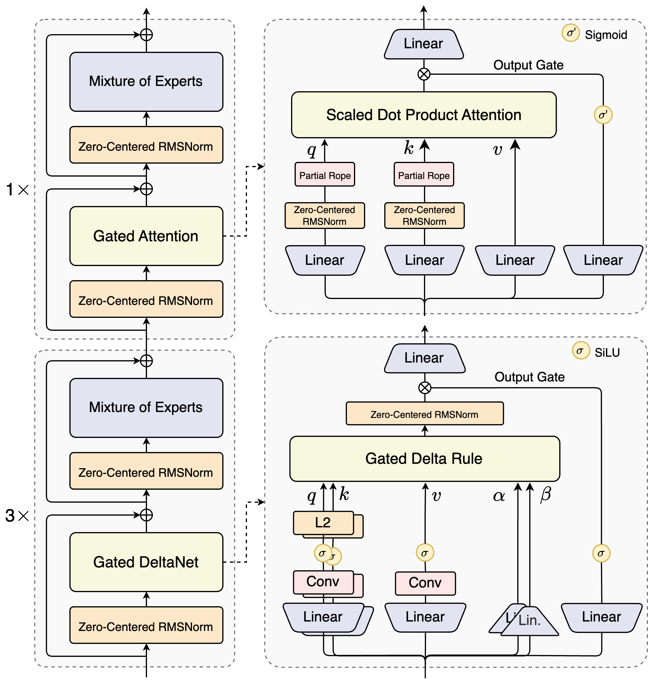

# Qwen3-Next: Towards Ultimate Training & Inference Efficiency

来源：[官方博客](https://www.alibabacloud.com/blog/qwen3-next-towards-ultimate-training-%26-inference-efficiency_602580)。

作者：Qwen Team（阿里巴巴）

## 混合注意力与整体架构

如图所示，Qwen3-Next 按 3:1 比例交替堆叠 Gated DeltaNet 线性注意力与 Gated Attention 标准注意力，兼顾长序列效率与上下文召回能力。基于该架构的 Qwen3-Next-80B-A3B 总参数 80B，每次推理仅激活 3B 参数。标准注意力层引入输出门控以缓解低秩问题，并仅对部分维度施加位置编码以增强长序列外推。线性注意力层则在投影分支加入短卷积与输出门控，配合 Gated Delta Rule 完成序列状态更新。

## 高稀疏 MoE 与稳定性设计

在全局负载均衡约束下，固定激活专家数并扩大专家总量可持续降低训练损失。Qwen3-Next 将每层专家扩展至 512 个，每次前向路由激活 10 个路由专家与 1 个共享专家。为保障混合高稀疏架构的数值稳定，注意力输出门控消除了 Attention Sink 与异常大激活值。模型还将归一化层改为 Zero-Centered RMSNorm 并施加权重衰减，同时在初始化时归一化路由参数以保证早期专家均衡选择。

## 多 Token 预测与训练推理效率

Qwen3-Next 引入原生 MTP 机制，并通过训练与推理一致的多步训练提升投机解码接受率与模型性能。得益于高稀疏度与混合注意力，Base 模型算力开销仅为稠密模型 Qwen3-32B 的约十分之一，后训练阶段进一步解决了该架构在 RL 训练中的稳定性瓶颈。模型原生支持 256K 上下文，在超过 32K 的长序列下 prefill 与 decode 吞吐均达到 Qwen3-32B 的 10 倍以上。
