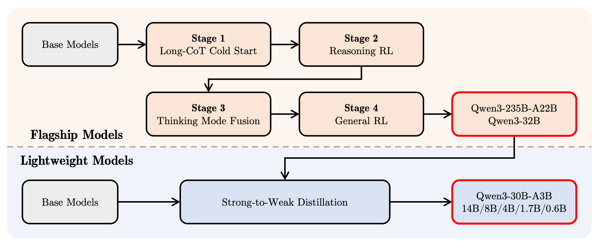
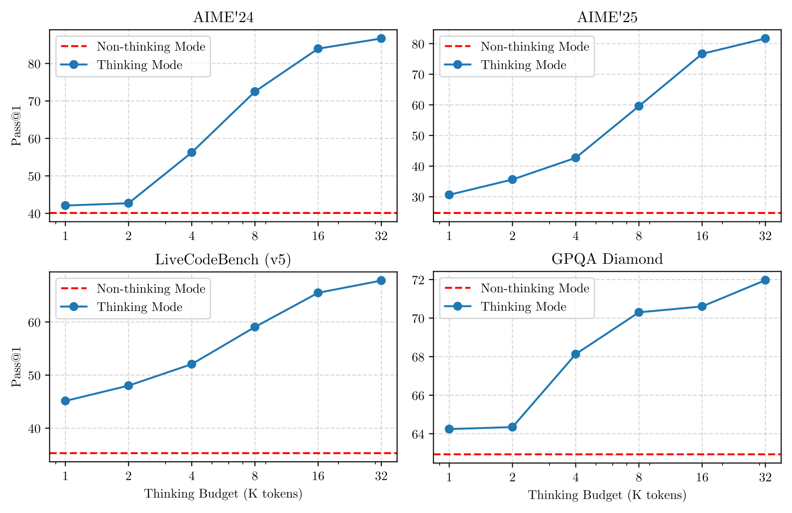

# Qwen3 Technical Report

arXiv 技术报告（[arXiv:2505.09388](https://arxiv.org/abs/2505.09388)）。

作者：Qwen Team（阿里巴巴）

## 模型系列与架构

Qwen3 同时包含稠密与 MoE 两类模型，参数规模覆盖 0.6B 至 235B，其中旗舰模型 Qwen3-235B-A22B 总参数为 235B、每 token 激活 22B 参数。稠密模型在 Qwen2.5 基础上移除注意力 QKV 偏置，并引入 QK-Norm 以保证大规模训练稳定性。MoE 模型采用细粒度专家切分，每层设 128 个专家并激活其中 8 个。与前代不同，Qwen3-MoE 取消了共享专家设计，改用全局 batch 负载均衡损失促进专家特化。

## 预训练数据与三阶段训练

Qwen3 将预训练语料翻倍扩展至 36T token，支持语言与方言从 29 种扩充至 119 种。语料构建通过视觉语言模型提取海量 PDF 文本并由语言模型润色，同时利用数学和代码专用模型合成推理数据。团队还基于多维质量标签在小规模代理模型上做实例级数据配比优化。预训练分三阶段推进：第一阶段在超 30T token 上建立多语种与通用知识基础；第二阶段在约 5T 高密度推理与代码数据上强化逻辑能力；第三阶段将上下文扩展至 32K，并结合 YaRN 与 Dual Chunk Attention（DCA）在推理时外推至 128K。

## 后训练整体流程

如图所示，Qwen3 对旗舰模型采用四阶段后训练流程，对轻量模型则直接采用强到弱知识蒸馏。第一阶段为长思维链冷启动，剔除无需推理即可答对的简单问题，仅用精简的高质量轨迹建立思考范式，避免限制后续探索上限。第二阶段为推理 RL，在冷启动未见过的高难度可验证问题上执行 GRPO 训练，并通过控制策略熵稳定平衡探索与利用。后两个阶段再依次融合非思考模式并强化通用场景对齐。

## 思考模式融合与思考预算

如图所示，Qwen3 在单一模型中统一了思考模式与非思考模式，支持通过思考预算在 1K 至 32K token 范围内平滑调节推理开销与性能。第三阶段通过对推理模型继续 SFT，混合自采样思考轨迹与多样化常规指令数据。对话模板引入 `/think` 与 `/no_think` 标记实现动态切换，非思考模式保留空思考块以维持内部格式一致。模式融合使模型自然具备基于未完成推理作答的能力，当思考长度达到预算阈值时插入截断提示即可直接生成最终回答。

## 通用强化学习

第四阶段通用 RL 在 20 余类任务上全面强化指令遵循、格式遵循、偏好对齐与多轮工具调用 agent 能力。其中格式遵循要求模型准确响应模式切换标记并规范输出思考分隔符，agent 训练则在 rollout 中引入真实环境的多轮执行反馈。为兼顾不同任务的评估特性，奖励系统联合使用了高精度规则奖励、基于参考答案的模型打分以及无参考答案的人类偏好奖励模型。

## 强到弱知识蒸馏

针对轻量稠密模型与 Qwen3-30B-A3B，Qwen3 用两阶段强到弱蒸馏替代耗时的四阶段后训练。第一阶段为 off-policy 蒸馏，合并旗舰教师模型在思考与非思考模式下的回复训练学生模型，注入基础推理能力与模式切换习惯。第二阶段为 on-policy 蒸馏，由学生模型在两种模式下自主采样序列，通过最小化与教师模型输出 logits 之间的 KL 散度完成对齐。相比直接在小模型上执行 RL，on-policy 蒸馏仅需约 1/10 的 GPU 时，同时显著提升单次准确率与推理探索上限。
