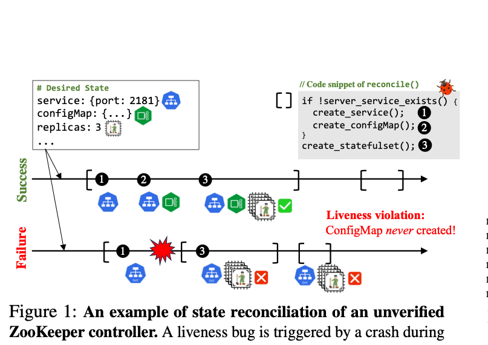
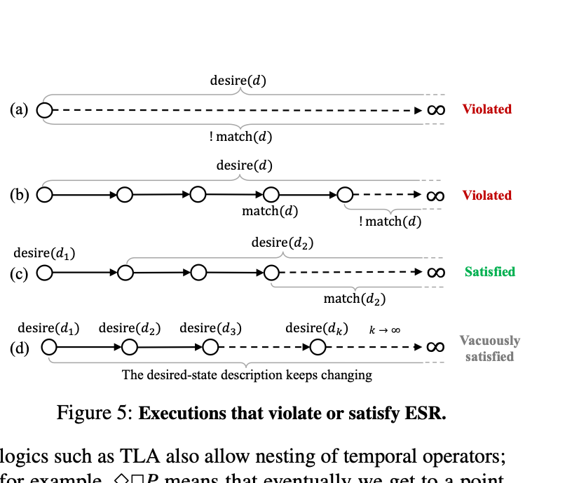
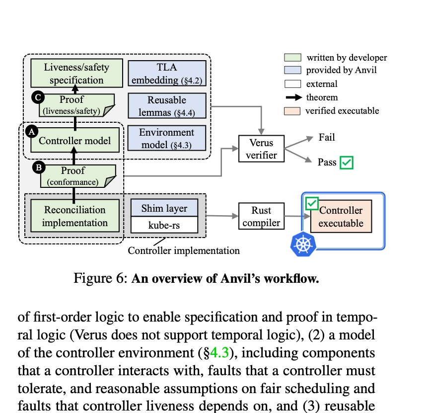

# Anvil: Verifying Liveness of Cluster Management Controllers

发表于 [OSDI '24](https://www.usenix.org/conference/osdi24/presentation/sun-xudong)。

作者：Xudong Sun¹、Wenjie Ma¹、Jiawei Tyler Gu¹、Zicheng Ma¹、Tej Chajed²、Jon Howell³、Andrea Lattuada³、Oded Padon³、Lalith Suresh⁴、Adriana Szekeres³、Tianyin Xu¹（¹University of Illinois Urbana-Champaign，²University of Wisconsin-Madison，³VMware Research，⁴Feldera）

## 动机和挑战

Kubernetes 等集群管理系统由大量 controller 组成，每个 controller 持续将集群当前状态 reconcile 到声明式期望状态。真实 controller 在并发、异步和故障下常出现永远无法到达期望状态的 bug；已有测试工具在热门 controller 中发现大量此类问题，但形式化工作此前多关注 safety，而 reconcile 本质上是 liveness 性质。

如图所示，ZooKeeper controller 在 `create_service` 后崩溃，重启后因 service 已存在而跳过 `create_configMap`，导致 ConfigMap 永远无法创建。这类 intermediate-state bug 在真实 K8s controller 中很常见。

## Eventually Stable Reconciliation

Anvil 将 controller 正确性形式化为 Eventually Stable Reconciliation（ESR）：progress 要求期望状态不变时集群最终匹配；stability 要求一旦匹配后，在期望不变时保持匹配。用 TLA 写作：

$$
\forall d.\ \Box\big(\Box\,\mathrm{desire}(d) \Rightarrow \Diamond\Box\,\mathrm{match}(d)\big)
$$

即若期望状态描述 $d$ 此后一直不变，则最终会到达并始终保持与 $d$ 匹配的状态。验证目标常改写为 leads-to 形式：$\Box\,\mathrm{desire}(d) \leadsto \Diamond\Box\,\mathrm{match}(d)$。

如图所示，(a) 永不匹配、(b) 匹配后再次偏离均违反 ESR；(c) 期望稳定后最终并保持匹配则满足；(d) 期望不断变化时性质平凡成立。分析表明，测试工具发现的 70 个永不匹配类 bug（约占全部的 69%）以及匹配后因冲突再次偏离的稳定性问题，均可被 ESR 排除。

## Anvil 框架

Anvil 基于 Verus，用 Rust 实现可部署的 controller，并机械证明其满足 ESR。开发者先写抽象状态机模型，再证明两件事：实现符合模型，以及模型在环境模型下满足 ESR。

如图所示，Anvil 提供 TLA embedding（在一阶逻辑上编码时序算子）、环境模型（网络、其他 controller、故障与公平性假设）和可复用引理；实现经 shim 与 kube-rs 编译为可在 K8s 上运行的可执行文件。

## 证明策略

ESR 证明在"最终稳定环境"下分三步：当前 reconcile 最终终止；终止后新一轮 reconcile 最终启动；从初始内部状态出发，controller 最终实现期望状态。证明大量使用 leads-to 传递性、弱公平性规则（WF1）以及垃圾回收等环境引理，使开发者主要对状态与动作做局部推理。

## 案例

作者用 Anvil 验证了管理 ZooKeeper、RabbitMQ 和 FluentBit 的三个 K8s controller，功能与性能对标广泛使用的未验证实现，并可直接部署；另为 RabbitMQ controller 证明了一条 safety 性质。ZooKeeper 的 ESR 证明约两人月，其余两个约两人周；验证过程发现了测试未检出、且存在于参考实现中的深层 bug。
