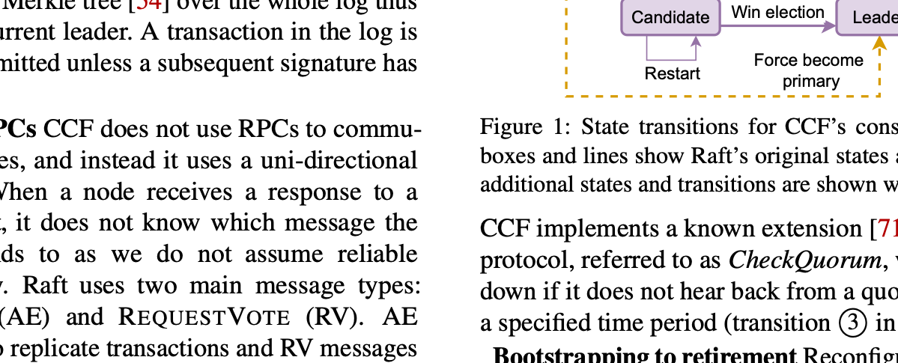
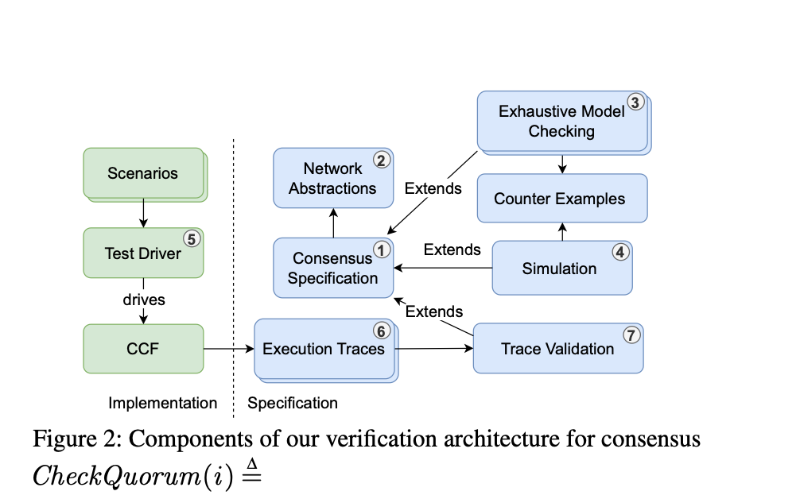

# Smart Casual Verification of the Confidential Consortium Framework

发表于 [NSDI '25](https://www.usenix.org/conference/nsdi25/presentation/howard)。

作者：Heidi Howard¹、Markus A. Kuppe¹、Edward Ashton¹、Amaury Chamayou¹、Natacha Crooks¹²（¹Microsoft Azure Research，²UC Berkeley）

## 动机和挑战

Confidential Consortium Framework（CCF）是面向可信云应用的开源平台，支撑 Azure Confidential Ledger 等生产服务：用 TEE 提供机密与代码完整性，用可审计的复制账本保证数据完整性与高可用。其共识基于 Raft 但已大幅改造（单向消息、签名事务、动态重配置、CheckQuorum 等），属于未经验证的新算法；实现约 63 kLoC C++，且持续快速演进，无法为验证重写。

作者希望同时检查分布式 safety、把一致性保证写成可读文档、把实现与规约对齐，并把验证嵌入已有 CI，使普通贡献者可维护。

## Smart Casual Verification

全文称其方法为 smart casual verification：在传统测试（casual）之上，用 TLA+ 形式规约与模型检测增加严谨性，但不追求从证明合成可执行代码的完整形式化验证。核心做法是把 TLA+ 规约绑定到现有 C++ 实现，并接入 CI，使规约随代码共同演化。

## 共识协议差异

如图所示，实线框为 Raft 原有 Follower / Candidate / Leader 及选举转移；虚线为 CCF 扩展，包括 CheckQuorum（Leader 在一段时间无法联系到 quorum 时退回 Follower）、ProposeVote、Force become primary，以及 Joiner / Retiring 等重配置相关状态。此外 CCF 用单向消息而非 RPC，用签名事务（含 Merkle 根）提供离线日志完整性，并用类似 joint consensus 的配置事务做节点增减。

## 验证架构

如图所示，规约侧以共识规约为核心，叠加网络抽象，用穷尽模型检测与仿真找反例；实现侧由场景与 Test Driver 驱动 CCF，产出执行轨迹，再经 Trace Validation 对照规约。规约含 17 个动作与 13 个变量，并检查 State Machine Safety：跨节点的 `LogInv`（已提交日志互为前缀）与单节点的 `AppendOnlyProp`（已提交日志只增不改）。

## 一致性模型

受早期 SGX 内存限制，CCF 在 Leader 执行后即可向客户端返回结果，而不必等待复制完成。事务对客户端可见为 COMMITTED、PENDING 或 INVALID：PENDING 类似 fork-linearizability，失败 Leader 可导致分叉后失效，但最终提交的分支仍保持线性化；客户端用 $\langle t.i\rangle$ 事务标识判断祖先提交等性质。作者为此单独形式化了含 PENDING / 分叉的客户端一致性规约。

## 结果

该方法嵌入 CCF CI，在进入生产前发现设计与实现中的 6 个细微 bug（如新 term 下乐观回滚违反 Leader Completeness、AE-ACK 的 LASTINDEX 不准确、过早节点退休等）；其中若干由轨迹校验在已有功能测试输出上暴露，而原测试断言不够强。作者强调轨迹校验可在每个状态检查不变量，比在场景中手工插入断言更有效。
