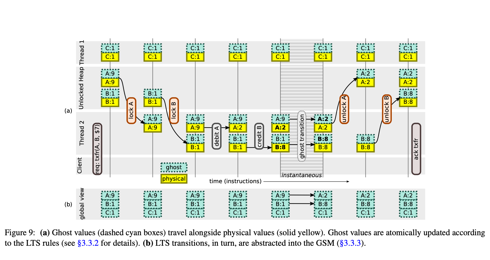
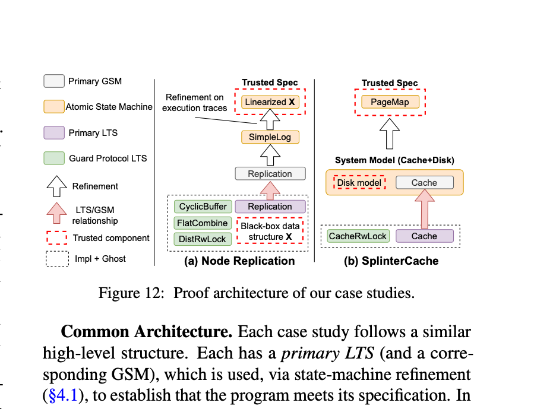

# Sharding the State Machine: Automated Modular Reasoning for Complex Concurrent Systems

发表于 [OSDI '23](https://www.usenix.org/conference/osdi23/presentation/hance)。

作者：Travis Hance¹、Yi Zhou¹、Andrea Lattuada²、Reto Achermann³、Alex Conway²、Ryan Stutsman²⁴、Gerd Zellweger²、Chris Hawblitzel⁵、Jon Howell²、Bryan Parno¹（¹Carnegie Mellon University，²VMware Research，³University of British Columbia，⁴University of Utah，⁵Microsoft Research）

## 动机和挑战

共享内存并发系统难写对：任一线程的正确性可依赖其他线程的交错；高性能实现还常用自定义同步，把同步与应用逻辑缠在一起。已有验证要么避开共享内存，要么依赖大量手工证明，要么自动化无法扩展到生产规模。IronSync 面向带自定义同步协议的生产级共享内存并发系统，把系统级证明拆成可分别自动化的局部问题。

## Ownership 与局部正确性

IronSync 基于 Linear Dafny 的 ownership 类型：owned 值由唯一变量持有，类型检查保证 data safety（内存安全且无冲突读写）。线程在只操作 owned 数据的代码段上，可用传统顺序验证技术证明局部逻辑正确性。锁等同步原语通过 lock invariant 交接所有权：加锁时可假设不变量，解锁时须重新证明。

## Localized Transition System

细粒度锁下，线程一次只持有全局状态的一小部分，难以直接对全局具体状态推理。IronSync 引入 Localized Transition System（LTS）：把抽象程序状态切成与实现并发粒度匹配的 shard，并定义只作用于少量 shard 的局部转移。例如银行转账的 LTS 以单账户为 shard，`transfer` 只交换 A、B 两个 shard，其他账户无关。

如图所示，虚线青框为 ghost、实线黄框为物理值；线程加锁后拿走对应 shard，本地 debit/credit 后经瞬时 ghost transition 原子更新逻辑状态，再解锁写回。LTS 转移进一步抽象为 Global State Machine（GSM）上的原子转移，使全局推理不必处理锁与交错细节。

## Guard Protocol

生产系统常见读共享模式超出朴素 ownership。IronSync 用次级 LTS 作为 guard protocol，把复杂同步（如 cyclic buffer、读写锁）从核心应用逻辑中拆出：证明 guard 的存在与对象存取一致后，线程可持有 shared 引用做只读访问，从而在应用层继续用顺序风格推理。

## 案例与架构

如图所示，各案例均有 primary LTS 及其 GSM，经状态机精化连到 trusted 规约；同步细节由若干 guard protocol LTS 承担。作者验证了 NUMA 感知的 Node Replication（NR）库与高并发页缓存 SplinterCache，实现由 Dafny 编译为 C++，性能接近参考实现；证明过程确认了参考代码中的线性化违反与数据竞争等问题。
