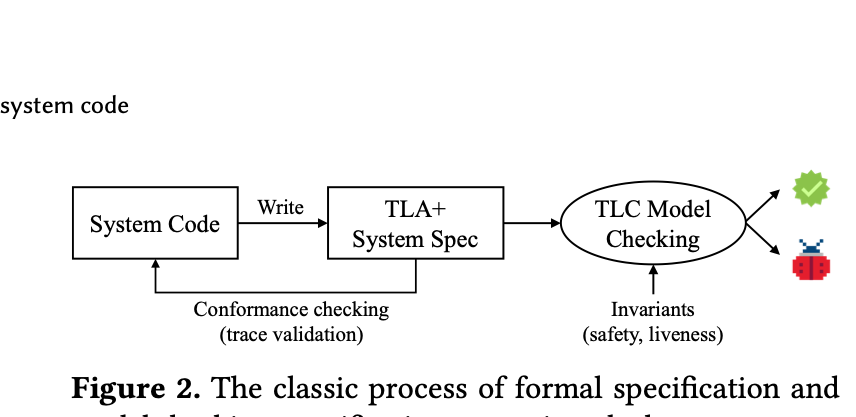
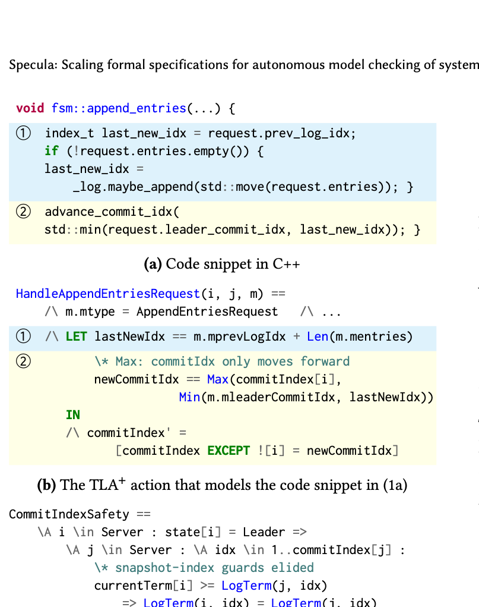
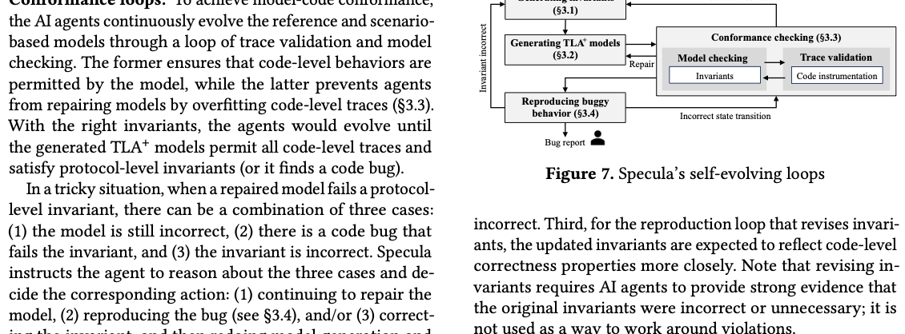

# Specula: Scaling formal specifications for autonomous model checking of system code

挂于 [arXiv:2607.25333](https://arxiv.org/abs/2607.25333)（尚未正式发表）。

作者：Qian Cheng¹、Saad Mohammad Rafid Pial²、Ruize Tang³、Yiming Su²、Emilie Ma⁴、Finn Hackett⁴、Ivan Beschastnikh⁴、Yu Huang¹、Tianyin Xu²（¹Nanjing University，²University of Illinois Urbana-Champaign，³Microsoft Research Asia，⁴University of British Columbia）

## 动机和挑战

对真实并发/分布式代码做模型检测，传统流程依赖专家手工写 TLA+ 模型与不变量，再用 TLC 找违反并用轨迹校验对齐实现。

如图所示，写规约、模型检测与 trace validation 形成闭环，但人工成本高。直接用 coding agent 写规约仍常失败：上下文装不下大仓库、抽象层次不当、以及为通过校验而弱化不变量等 reward hacking。

## 整体思路

Specula 是 push-button 的 agentic 系统：从目标系统仓库出发，由 LLM coding agent 自动生成 TLA+ 规约（系统模型 + safety/liveness 不变量），用 TLC 做模型检测，并把违反在代码层复现。目标是规约精确、模型对找深层 bug 足够细且可检测、且与代码一致从而结果可复现。

如图所示，agent 把实现级行为抽象成 TLA+ 动作，并写出如 `CommitIndexSafety` 一类不变量；规约既可含协议级性质，也可含实现级细节。

## Self-evolving loops

如图所示，Specula 用两组互相依赖的循环驱动演化：conformance loop 交替做 trace validation（模型须允许代码行为）与对协议级不变量的模型检测（防止为过轨迹而过拟合模型）；reproduction loop 把模型层反例落到可控调度的代码测试。不变量违反时，agent 须在"模型仍错 / 代码有 bug / 不变量本身错"三者间取证并回修，直到收敛或产出可复现 bug。

## 建模与复现

不变量从代码、注释、文档与 issue 等产物归纳，并据此决定抽象粒度；对同一系统可生成多种场景模型（如关掉崩溃、替换选举）以控制状态空间。发现违反后，agent 按客户端 API、外部 sleep、状态前置条件、代码内 sleep 等层次强制重放模型轨迹；无法复现则把分歧状态反馈回 conformance。

## 结果

默认用 Claude Code + Opus-4.8，检查 48 个开源系统（含 MongoDB、Etcd、ScyllaDB、GCC libgomp 等），找到 249 个 bug，均在代码层复现、无假阳性；已报告 89 个，其中 68 个确认、24 个已修。端到端单系统约 1.43–9.86 小时。开源见 [specula-org/Specula](https://github.com/specula-org/Specula)。
