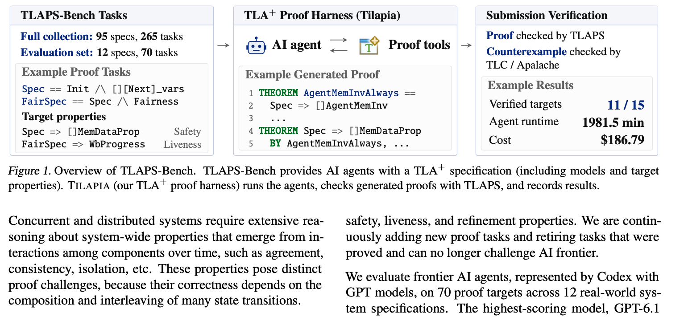
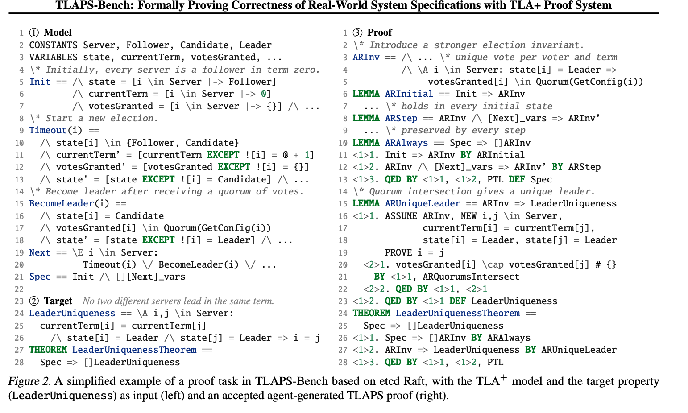

# TLAPS-Bench: Formally Proving Correctness of Real-World System Specifications with TLA+ Proof System

挂于 [arXiv:2611.02849](https://arxiv.org/abs/2611.02849)（尚未正式发表）。

作者：Qian Cheng¹、Ruize Tang²、Saad Mohammad Rafid Pial³、Zhizhen Cathy Cai³、Yiming Su³、Jackson Clark³、Munim Thahmid⁴、Mahdiya Rahman Sukanya⁵、Chris Newcombe⁶、Igor Konnov⁷、Stephan Merz⁸、Xudong Sun⁹、Murat Demirbas¹⁰、Yu Huang¹、Markus Alexander Kuppe⁷、Tianyin Xu³‚¹¹（¹Nanjing University，²Microsoft，³University of Illinois Urbana-Champaign，⁴Bangladesh University of Engineering and Technology，⁵IIT, University of Dhaka，⁶Oracle，⁷Independent，⁸University of Lorraine / CNRS / Inria，⁹University of Toronto，¹⁰MongoDB，¹¹UC Berkeley）

## 动机和挑战

并发与分布式系统的正确性依赖 agreement、consistency、isolation 等全局性质，通常要用 TLA+ 规约并用演绎证明覆盖无限执行；构造归纳不变量、分解证明义务仍极耗专家人力。现有 agent 证明基准多给好辅助引理或预设分解，评的是补全而非端到端发现；且对象常是为验证特制的研究工件，而非 etcd、MongoDB 等真实系统规约。

## 整体架构

TLAPS-Bench 面向真实系统/协议的 TLA+ 规约，以 proof target（待证性质）为任务单元；配套 harness **Tilapia**（TLA+ Proof Infrastructure for Agents）让 coding agent 在 TLAPS 上迭代写证明。

如图所示，任务提供模型与目标性质；agent 调用语义分析、模型检测与证明库生成证明；提交由 TLAPS 校验证明，反例由 TLC / Apalache 校验。全库含 95 个规约、265 个 target，评测子集为 12 个规约、70 个 target，覆盖 safety、liveness 与 refinement。

## 任务形态

如图所示，输入是状态机模型与目标定理（如同 term 至多一个 Leader）；agent 需自行发现更强归纳不变量（如选票唯一性与 quorum），再经引理链证到目标。接受标准是 TLAPS 机械通过，而非有限模型检测。

## Tilapia

Tilapia 向 agent 提供 SANY、TLC、Apalache、常用证明库与使用技能，并限制可编辑区域。为防 reward hacking，接受证明须同时满足：不改动原规约与目标（context integrity）、依赖引理均已证明（dependency tracking）、在干净容器中用未篡改工具重跑（clean-room grading）。作者用该 harness 为此前未证明的 cache coherence、Byzantine consensus、WAL 等规约补出了性质证明。

## 评测

在 Codex + GPT 模型上评测 70 个 target：最高配置 GPT-6.1 Sol（max）通过 31 个（44.3% pass@3）。简单协议（如 FLASH、OpenAddressing）可全过；etcd Raft 能证 leader uniqueness / log matching，但 committed 日志一致性与耐久性仍失败；ZooKeeper 协议与系统规约则全部未过。失败常卡在不变量选择与把大 SMT 义务拆开，而非单纯调用后端。
