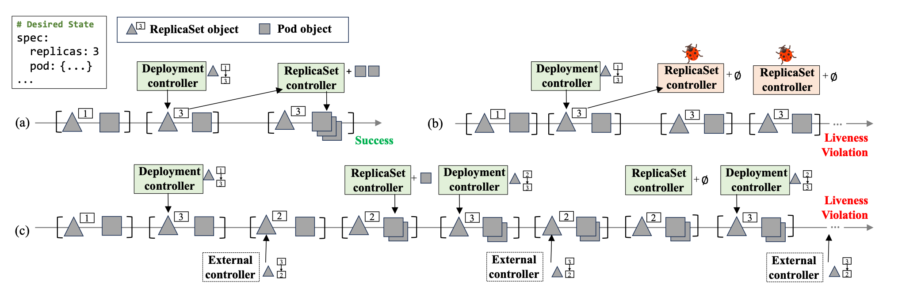
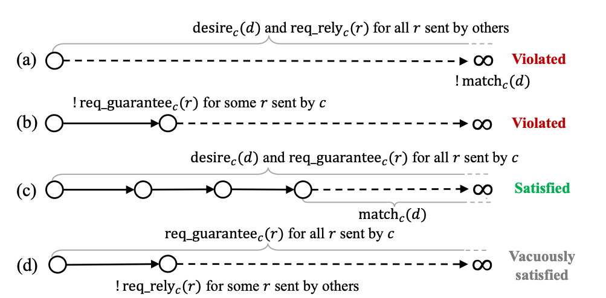
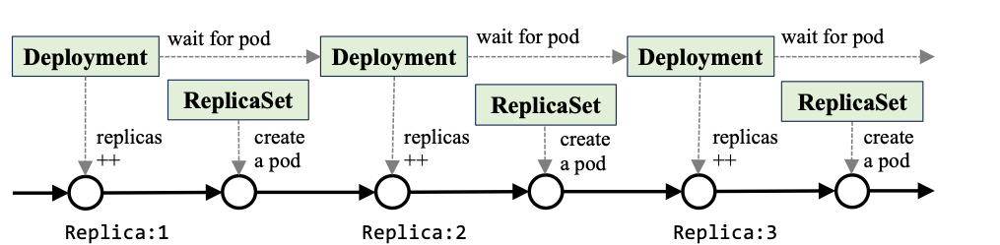

# Welder: Compositional Liveness Verification of Cluster Control Planes

## 动机和挑战

Kubernetes（K8s）控制面由多个 controller 组成，每个 controller 循环执行 reconcile，将集群当前状态驱动到用户声明的期望状态；controller 之间不直接通信，只经 API server 读写共享状态。KubeRay、Kubeflow 等 AI 作业 operator 均属此类。

如图所示，Deployment 通过 ReplicaSet 间接管理 Pod，二者协作时存在两类 liveness（系统最终收敛）失效：(b) 下层 controller 不收敛，上层永远等待；(c) 外部 controller 反复修改同一对象，系统持续振荡。这类问题只在多个 controller 共同运行时出现，而前作 Anvil 只能在固定环境中验证单个 controller。

## CORE 规约

Welder 以 rely-guarantee 形式为一组 controller $S$ 定义 COmpositional REconciliation（CORE）规约：

$$
\mathrm{CORE}_S \triangleq M_S \models \big((R_S \land D_S) \Rightarrow \mathit{ESR}_S\big) \land G_S
$$

即在 $S$ 与任意其他 controller 共存的所有执行 $M_S$ 中，若外部不干扰 $S$（$R_S$）且下层依赖收敛（$D_S$），则 $S$ 中每个 controller 均完成协调，且 $S$ 不干扰外部（$G_S$）。其中协调目标沿用 Anvil 的 Eventually Stable Reconciliation（ESR）：

$$
\mathit{ESR}_c \triangleq \forall d,\ \Box\,\mathrm{desire}_c(d) \leadsto \Box\,\mathrm{match}_c(d)
$$

即期望状态 $d$ 保持不变后，集群最终与 $d$ 一致并始终保持。

如图所示，(a) 无干扰但未收敛、(b) 越界修改均违反 CORE，(c) 满足 CORE，(d) 因外部先违反 rely 而平凡成立。rely 与 guarantee 按请求定义，并借 owner 引用划分所有权：外部请求不得修改 $c$ 拥有的对象，$c$ 只修改自身对象，因此条件可局部书写，新增 controller 无需改动已有证明。在现有测试工具发现的 188 个 controller bug 中，CORE 可排除 178 个。

## Liveness 依赖

如图所示，滚动升级时 Deployment 逐步增加 ReplicaSet 的副本数并等待其收敛，这与 ESR 要求期望状态不变相矛盾。Welder 利用上层修改的单调性对剩余差距做强归纳，证明修改最终停止、下层 ESR 随之可用，并将该推理抽象为 Iter-ESR 规则。

## 对象共享

K8s 以版本号实现乐观并发，多个 controller 修改同一对象时，冲突方可能持续饥饿，而 weak/strong fairness 无法排除这种执行。Welder 在模型中提供原子的 check-then-update 事务，实现上用 Retry-on-Conflict（RoC）循环模拟，并在"RoC 循环终止"的公平假设下证明其精化为事务，使 liveness 证明无需处理版本冲突。

## 干扰

Welder 将非干扰推理统一为状态保持不变量：凡非 $c$ 为 $d$ 发出的请求，均不改变 $d$ 管辖的状态，对应 rely-guarantee 中的 stable assertion。证明由此分为两步：先用 rely 证明该不变量，再证明 $c$ 的每一步使状态趋近 $d$。

## 组合

组合两组 controller 只需证明一方的 guarantee 蕴含另一方的 rely，可逐请求检查。无依赖时用 Compose 规则，存在单向依赖时用 Compose-Dep，以被依赖方的 ESR 满足依赖方的 $D_S$，要求依赖关系无环。

## 框架

Welder 基于 Anvil 和 Verus 实现，controller 以 Rust 状态机编写，环境模型可实例化为目标 controller 与任意其他 controller，覆盖异步网络、消息丢失、controller 崩溃和 Pod 故障。作者验证了 Deployment、ReplicaSet、StatefulSet 和 RabbitMQ 四个 controller，修复 7 个 bug，端到端性能与官方实现相当。
